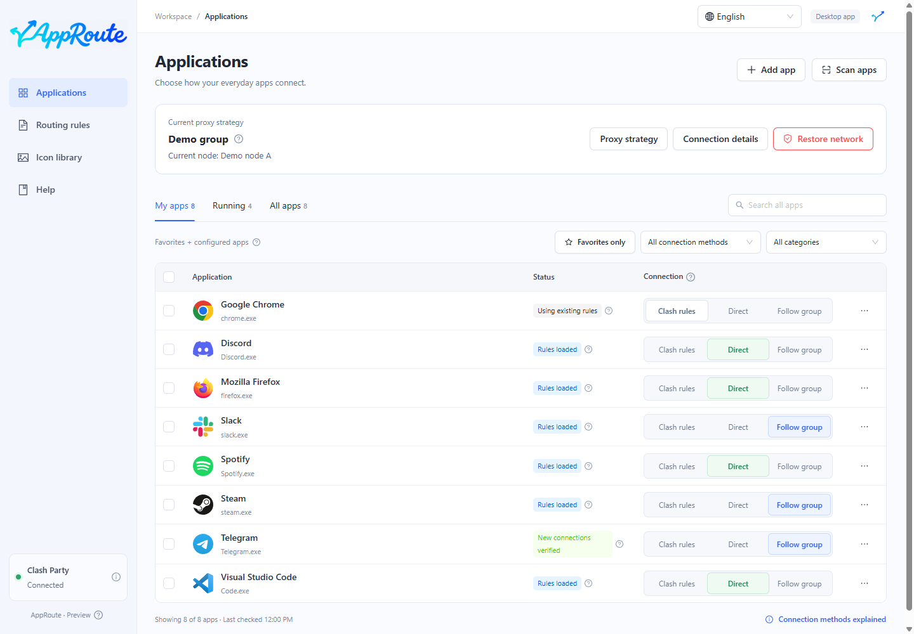
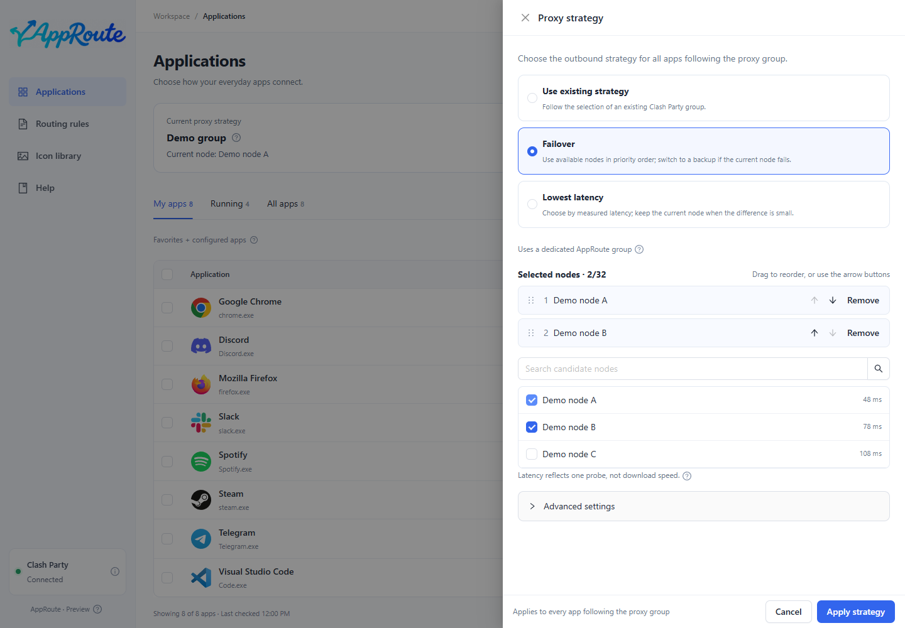
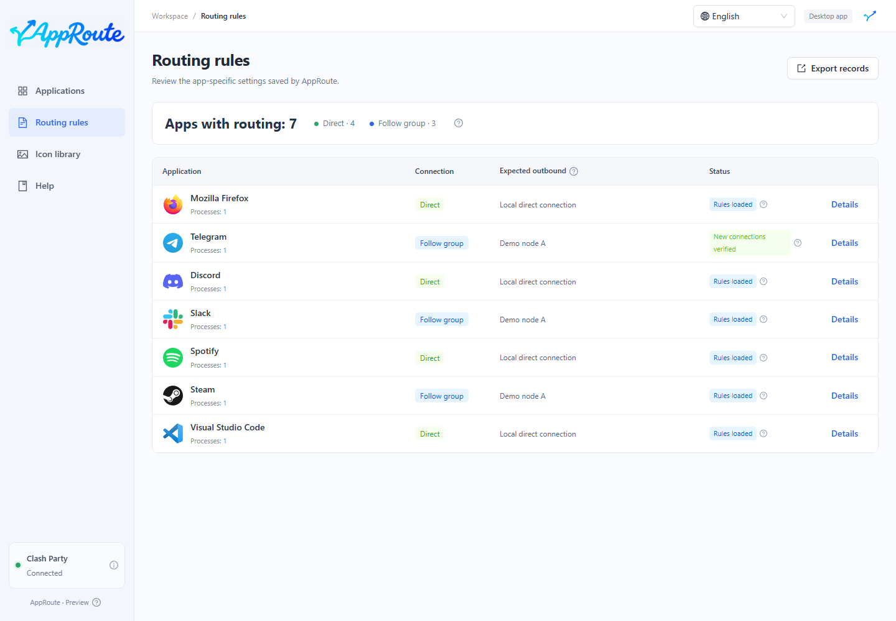
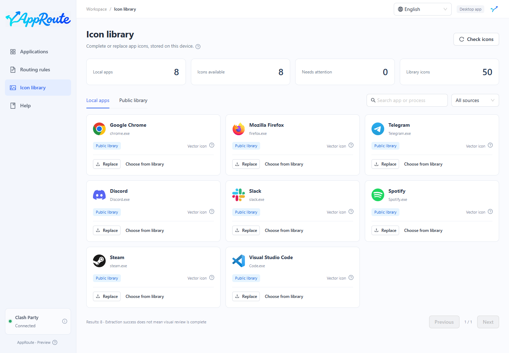
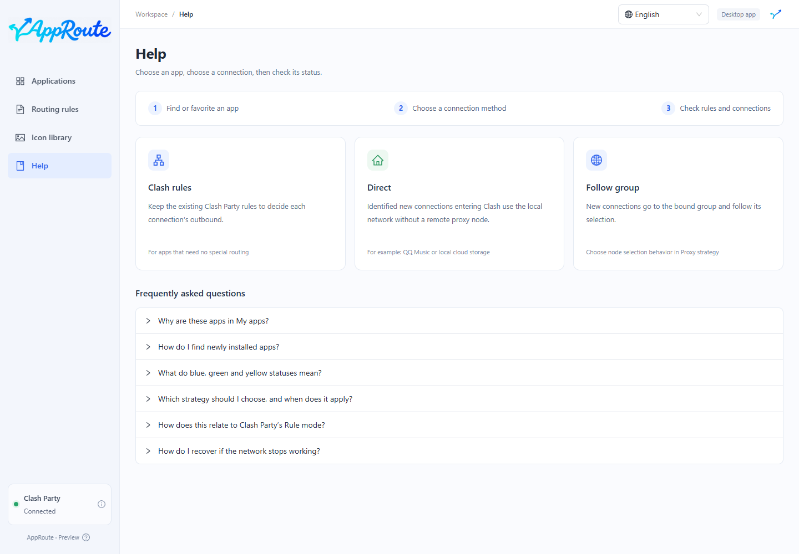

<p align="center"></p>
<p align="center"><strong>Choose how each app connects. No handwritten proxy rules.</strong></p>
<p align="center"><a href="README.md">简体中文</a> · English · <a href="README.ja.md">日本語</a> · <a href="README.fr.md">Français</a></p>

AppRoute is a Windows desktop companion for **Clash Party / Mihomo**. Discover apps, choose **Clash rules, Direct or Follow group**, and distinguish loaded rules from verified connections.

> **0.2.0-preview.1 — integration preview.** Local desktop builds and installation are available. There is no signed installer or automatic updater yet. Real client restarts, subscription changes, sleep and the full compatibility matrix still need acceptance testing.

## A look inside



Real Electron UI captures with **synthetic paths, proxy groups and connection records**. They illustrate the interface, not real network verification.

<details><summary>Proxy strategy, rules, icons and help</summary>






</details>

## Features

- **Click to apply:** queue successive choices, merge compatible changes and roll back failures.
- **Find your apps:** automatic discovery, executable picker, running filter and collapsed system tools. My apps means favorites plus apps with specific routing—not usage tracking.
- **Follow a group:** bind your usual Clash Party group once. New connections follow changes inside it.
- **Choose a strategy:** keep an existing group, order failover candidates, or prefer measured low latency. Mihomo runs automatic selection.
- **Check the result:** blue means rules loaded; green means matching new connections observed. Group selection and actual connection nodes remain distinct.
- **Desktop and tray:** close to tray; quitting preserves confirmed rules. Independent offline recovery is included.
- **Manage icons:** local extraction, 50 public icons, fallbacks and custom images stored locally.
- **Four languages:** Simplified Chinese, English, Japanese and French, with a persistent top-right selector.

## Connection methods

| Option | What happens to new connections |
| --- | --- |
| Clash rules | Existing Clash Party rules decide between direct and proxy routes. |
| Direct | Identified connections captured by Clash use DIRECT, without a remote proxy node. |
| Follow group | Uses the bound group’s selection or automatic strategy. DIRECT / REJECT members still mean direct / rejected connections. |

AppRoute supplies no nodes or subscriptions. Traffic outside Clash is not guaranteed to follow these settings. Existing connections are not forcibly switched. Original rules, system proxy and TUN settings are preserved. [Compatibility and boundaries](docs/COMPATIBILITY.md) (Chinese)

## Get started

Verified combination: **Windows, Clash Party 2.0.4 and Mihomo v1.19.32**, using Rule mode and the stable core. Other clients are not integrated yet. Build from source with Node.js 24 LTS (24.11 or newer within 24.x):

```powershell
git clone https://github.com/Yueyuyu/app-route.git
cd app-route
git switch codex/clash-party-recovery
npm ci
npm run desktop:build
npm run desktop:install
```

1. Start Clash Party and open the AppRoute desktop shortcut.
2. Choose your usual group in **Proxy strategy**, then apply it.
3. Find an app, choose its connection method, and inspect its status.
4. After the first override registration, quit and reopen Clash Party normally, then check that rules remain loaded.

The installed app includes its runtime: no browser, development server or separate Node installation is needed. The first launch follows the system language; unsupported languages fall back to Simplified Chinese. Change it using the top-right selector. [Desktop guide](docs/DESKTOP.md) (Chinese)

## Recover without internet

Failed changes roll back. An independent **120-second watchdog** protects transactions that have not completed confirmation. Use **Restore network** in the app, or **AppRoute - Restore Network** on the desktop if the app cannot open. Neither internet nor ChatGPT is required.

Recovery removes AppRoute-owned routing and automatic groups while preserving original subscriptions and system settings. It does not promise to fix unrelated network faults. Shutdown, sleep and watchdog termination remain acceptance-test gaps. [Recovery details](docs/RECOVERY.md) (Chinese)

## Brand and interface

<p> </p>

Inside the app, an asymmetric cyan-to-blue routing arrow joins the handwritten A in one continuous mark, without a subtitle. The desktop uses the approved dark gray-blue rounded background. Ant Design pages keep summaries visible and explanations in details or help.

[Brand lockup](docs/design/brand-lockup.md) · [Icon specification](docs/design/app-icon.md) · [Wordmark](docs/design/wordmark.md) · [UI conventions](docs/design/README.md) · [Third-party notices](THIRD_PARTY_NOTICES.md) (design documents in Chinese)

## Develop and contribute

```powershell
npm run dev          # Development preview only
npm run check        # Tests, type checking and build
npm run check:i18n   # Windows: isolated desktop language checks and demo captures
```

Language changes never rewrite routing or translate app identities, paths or node names. Unknown technical diagnostics retain their original language; the independent recovery command line remains Chinese. See [localization maintenance](docs/LOCALIZATION.md), [architecture](docs/ARCHITECTURE.md), [roadmap](docs/ROADMAP.md), [verification](docs/VERIFICATION.md) and [contributing](CONTRIBUTING.md) (Chinese).

App lists, favorites, icons and management records stay on your device. Remove credentials, subscriptions and personal paths before [reporting an issue](https://github.com/Yueyuyu/app-route/issues). Project code is [MIT-licensed](LICENSE); third-party licenses and trademarks remain separate.
