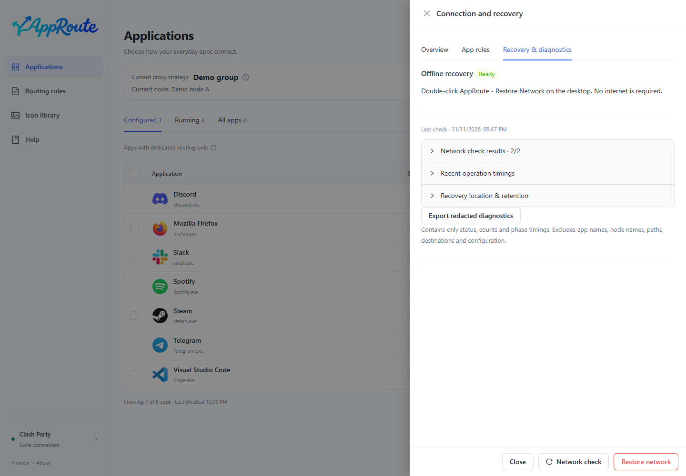
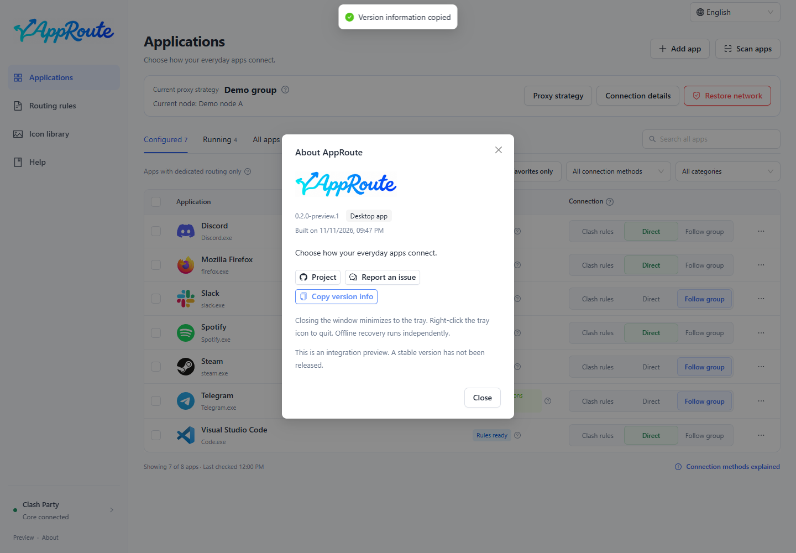

<strong>Choose how each app connects, without writing proxy rules.</strong>

<a href="README.md">简体中文</a> · English · <a href="README.ja.md">日本語</a> · <a href="README.fr.md">Français</a>

  <a href="LICENSE">MIT</a>

[Download](#download) · [Quick start](docs/guide/en/quickstart.md) · [Documentation](https://yueyuyu.github.io/app-route/en/) · [FAQ](docs/guide/en/faq.md) · [Report an issue](https://github.com/Yueyuyu/app-route/issues/new/choose)

AppRoute discovers installed apps and lets you choose **Clash rules, Direct, or Follow group**, with separate rule and connection verification. It works with an existing **Clash Party / Mihomo** setup and supplies no proxy nodes or subscriptions.

> **Windows preview · experimental macOS version.** No publisher signing, Apple notarization or auto-update. Real Mac routing and recovery still need device testing. [Support and limitations](docs/guide/en/install.md#support)

## Download

<!-- downloads:en:start -->
**Current preview: [0.2.0-preview.2](https://github.com/Yueyuyu/app-route/releases/tag/v0.2.0-preview.2)**

| Your computer | Download | Size | Checksum |
| --- | --- | --- | --- |
| Windows · Intel / AMD 64-bit | [Installer EXE](https://github.com/Yueyuyu/app-route/releases/download/v0.2.0-preview.2/AppRoute-0.2.0-preview.2-setup-x64.exe) | 140.8 MiB | [SHA-256](https://github.com/Yueyuyu/app-route/releases/download/v0.2.0-preview.2/AppRoute-0.2.0-preview.2-setup-x64.exe.sha256) |
| Mac · Apple silicon (experimental) | [DMG](https://github.com/Yueyuyu/app-route/releases/download/v0.2.0-preview.2/AppRoute-0.2.0-preview.2-mac-arm64.dmg) | 155.0 MiB | [SHA-256](https://github.com/Yueyuyu/app-route/releases/download/v0.2.0-preview.2/AppRoute-0.2.0-preview.2-mac-arm64.dmg.sha256) |
| Mac · Intel (experimental) | [DMG](https://github.com/Yueyuyu/app-route/releases/download/v0.2.0-preview.2/AppRoute-0.2.0-preview.2-mac-x64.dmg) | 161.6 MiB | [SHA-256](https://github.com/Yueyuyu/app-route/releases/download/v0.2.0-preview.2/AppRoute-0.2.0-preview.2-mac-x64.dmg.sha256) |

Other files: [arm64 ZIP](https://github.com/Yueyuyu/app-route/releases/download/v0.2.0-preview.2/AppRoute-0.2.0-preview.2-mac-arm64.zip) · [x64 ZIP](https://github.com/Yueyuyu/app-route/releases/download/v0.2.0-preview.2/AppRoute-0.2.0-preview.2-mac-x64.zip). Mac ZIP files are app archives; Source code is not an installer.

SHA-256 checks file integrity; it does not replace publisher signing.
<!-- downloads:en:end -->

The app includes its runtime. **No Node.js, browser or build commands are needed.** [Installation, architecture selection and checksums](docs/guide/en/install.md)

## See the interface

Screenshots use the real Electron interface with isolated demo data. They illustrate interaction, not verified real traffic.

Strategy, connection details and other pages

## What you can do

- **Choose per app:** discover real apps, search all apps, and filter configured, running or favorite apps.
- **Apply with a click:** queue and merge compatible changes; failed checks roll back. Rule readiness and connection verification remain separate.
- **Follow your usual group:** new connections follow node changes in Clash Party without configuring each app again.
- **Choose an automatic strategy:** use an existing group, failover priorities, or latency-based selection, executed by Mihomo.
- **Recover offline:** use in-app recovery or an independent entry while preserving original subscriptions and rules.
- **Use a desktop app:** tray controls, icon management, and Chinese, English, Japanese and French. First launch follows the system language.

## Connection methods

| Option | Meaning for identified, captured new connections |
| --- | --- |
| Clash rules | Existing Clash Party rules decide between direct and proxy routing. |
| Direct | Uses DIRECT without a remote proxy node. |
| Follow group | Uses the bound group’s selection or strategy. DIRECT / REJECT members still mean direct / rejected connections. |

Existing connections are not forcibly switched. Traffic outside Clash is not guaranteed to follow these rules. AppRoute does not enable TUN, change the system proxy or close other VPNs automatically.

## First use

1. Install AppRoute and keep your configured Clash Party running in Rule mode.
2. Open AppRoute and check that the bottom-left connection indicator is connected.
3. Find an app and choose **Direct**. For proxy routing, first bind your usual group in **Proxy strategy**, then choose **Follow group**.
4. Let the app establish a new connection and inspect its status and details. Blue rule readiness does not verify all traffic.

After the first override registration, quit and reopen Clash Party normally and verify that the rules remain loaded. [Step-by-step quick start](docs/guide/en/quickstart.md)

## Learn by task

[QQ Music direct routing](docs/guide/en/direct.md) · [Follow a proxy group](docs/guide/en/follow-group.md) · [Failover and latency](docs/guide/en/strategies.md) · [Update, uninstall and recover](docs/guide/en/maintenance.md)

If the network fails, use **Restore network** in the app, or **AppRoute - Restore Network** on the desktop if AppRoute cannot open. The independent entry is installed before the first rule change. It disables AppRoute-owned routing; it does not reset the system network or promise to fix faults caused by other software. [Recovery steps](docs/guide/en/maintenance.md#recovery)

## Develop and contribute

End users can use the installers above. Developers build from `main`; see [contributing and building](CONTRIBUTING.md) (Chinese).

[Architecture](docs/ARCHITECTURE.md) · [Roadmap](docs/ROADMAP.md) · [Verification](docs/VERIFICATION.md) · [Localization](docs/LOCALIZATION.md) · [Brand](docs/design/brand-lockup.md) · [Third-party notices](THIRD_PARTY_NOTICES.md). Technical documents are in Chinese.

App inventory, icons and management records stay on your device. Remove subscriptions, secrets, personal paths and raw logs before reporting issues. Original code is licensed under [MIT](LICENSE).
