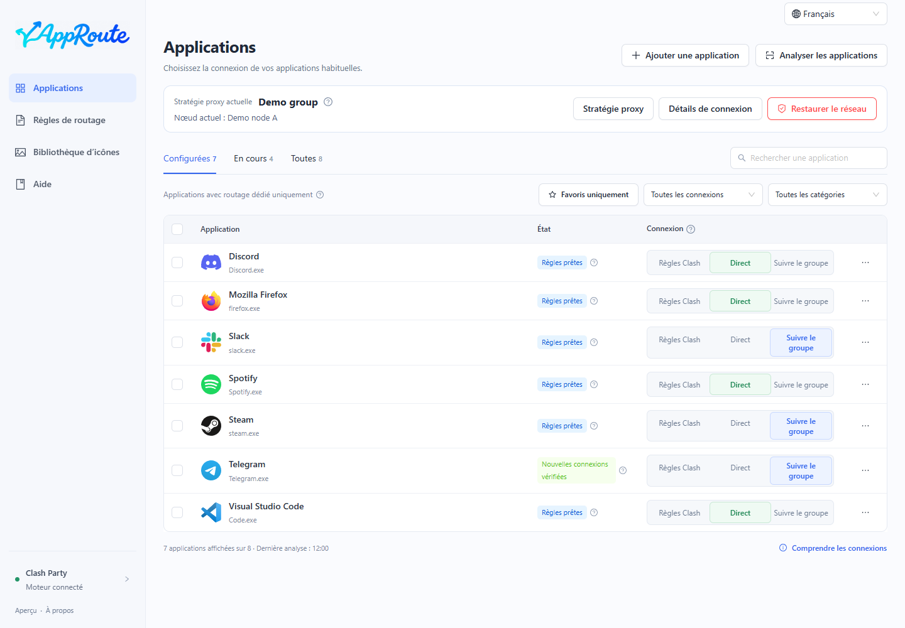
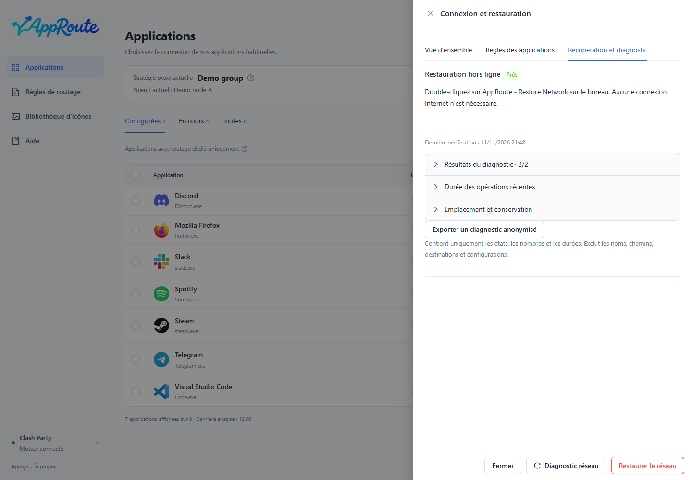
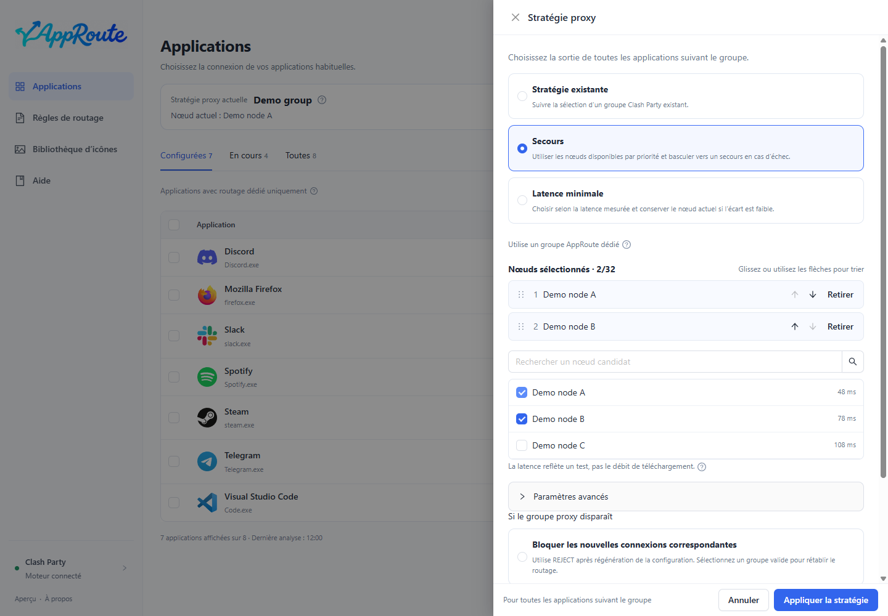
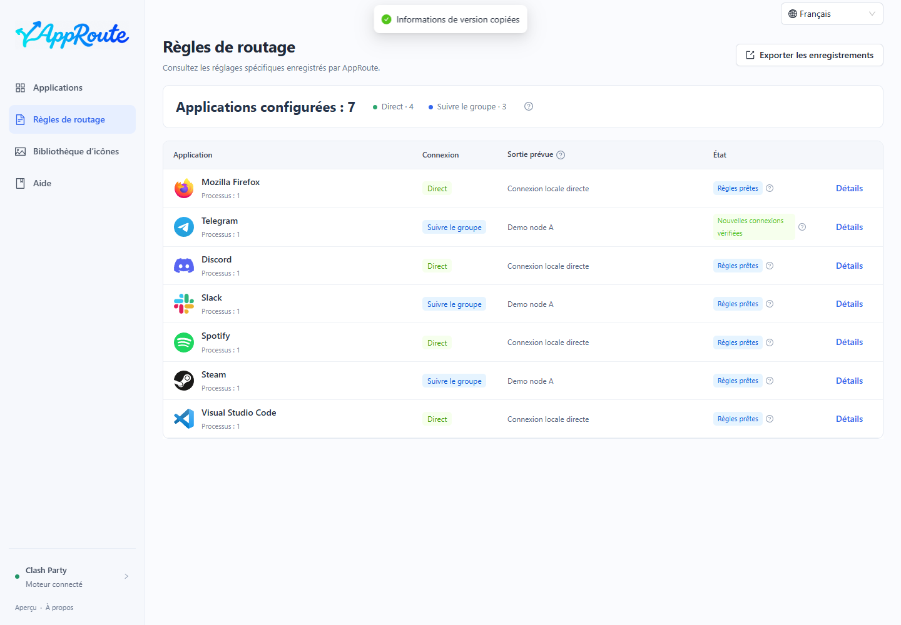
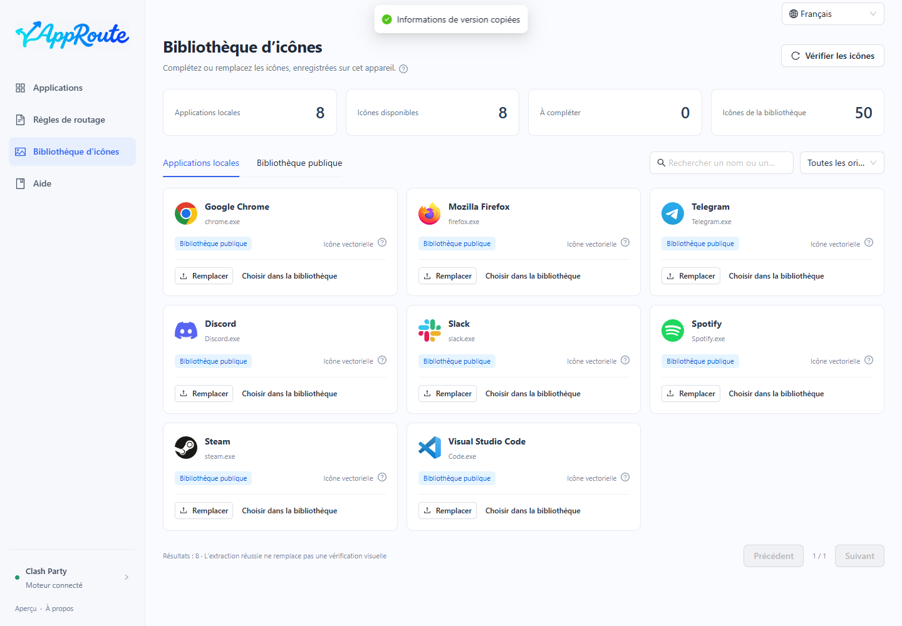
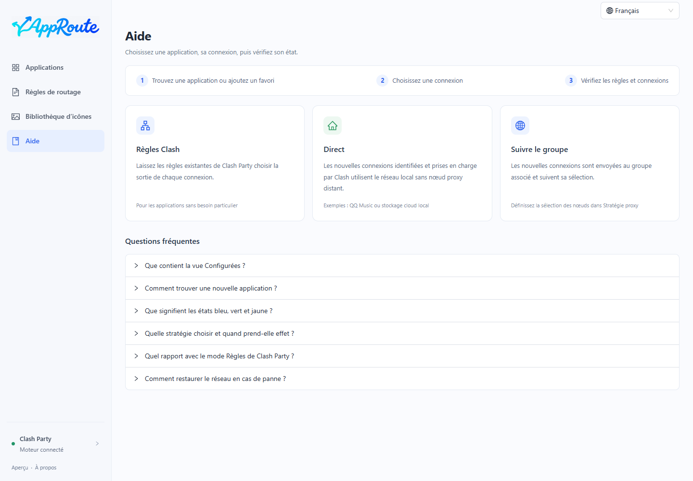
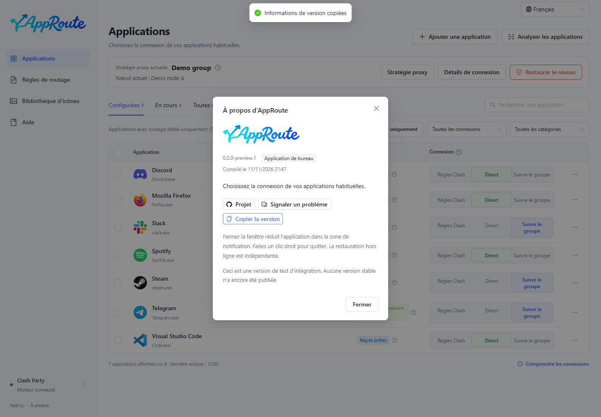

<p align="center"></p>
<p align="center"><strong>Choisissez la connexion de chaque application, sans écrire de règles proxy.</strong></p>
<p align="center"><a href="README.md">简体中文</a> · <a href="README.en.md">English</a> · <a href="README.ja.md">日本語</a> · Français</p>

AppRoute est une application de bureau (préversion Windows et version macOS expérimentale) qui accompagne **Clash Party / Mihomo**. Elle détecte vos logiciels et propose **Règles Clash, Direct ou Suivre le groupe**, en distinguant les règles chargées des connexions réellement vérifiées.

> **0.2.0-preview.1 · Préversion, pas une version stable.** Cibles : Windows x64, macOS Apple Silicon et Intel. Le redémarrage et le passage entre deux abonnements réels ont été vérifiés sous Windows. La mise à jour distante des abonnements, la veille réelle et le routage réel sur Mac restent à valider. Aucune signature d’éditeur, notarisation Apple ni mise à jour automatique.

[Téléchargements](https://github.com/Yueyuyu/app-route/releases) · [Périmètre macOS](docs/MACOS.md)

## Découvrir l’interface



Captures de l’interface Electron réelle avec des **chemins, groupes et connexions fictifs**. Elles ne constituent pas une preuve de routage réseau réel.



<details><summary>Stratégie proxy, règles, icônes et aide</summary>








</details>

## Fonctionnalités

- **Application au clic** : mise en attente des choix successifs, regroupement des changements compatibles et retour automatique en cas d’échec.
- **Découverte des logiciels** : analyse automatique, choix d’un exe, filtre des processus actifs et outils système repliés. Configurées contient uniquement les routages dédiés ; les favoris constituent un filtre séparé.
- **Suivi d’un groupe** : associez votre groupe habituel une fois ; les nouvelles connexions suivent ses changements.
- **Trois stratégies** : groupe existant, secours par priorité ou choix selon la latence mesurée. Mihomo exécute la sélection automatique.
- **Résultat vérifiable** : bleu pour les règles chargées en attente de trafic, vert pour les nouvelles connexions conformes observées. Sélection du groupe et nœuds réellement utilisés restent distincts.
- **Bureau et zone de notification** : fermer réduit l’application ; quitter conserve les règles confirmées. Restauration hors ligne indépendante incluse.
- **Gestion des icônes** : extraction locale, 50 icônes publiques, images par défaut et personnalisées, conservées localement.
- **Quatre langues** : chinois simplifié, anglais, japonais et français, avec sélection persistante en haut à droite.

## Améliorations récentes

Le démarrage et la sortie de veille vérifient les transactions interrompues. La disparition d’un groupe propose explicitement le blocage ou les règles initiales, sans changer le comportement existant. Les nouvelles applications sont signalées pendant sept jours. Les détails séparent aperçu, règles et récupération, avec durées et diagnostic anonymisé. La restauration des enregistrements exige la concordance du script, de la configuration générée et des règles actives. Les sauvegardes locales sont limitées. `npm run installer:build` génère un installateur NSIS par utilisateur qui conserve les données. Il reste non signé, sans mise à jour automatique.

[Implementation and acceptance](docs/MATURITY-PLAN.md) (Chinese)

## Méthodes de connexion

| Option | Traitement des nouvelles connexions |
| --- | --- |
| Règles Clash | Les règles existantes choisissent entre connexion directe et proxy. |
| Direct | Les connexions identifiées et prises en charge par Clash utilisent DIRECT, sans nœud distant. |
| Suivre le groupe | Utilise la sélection ou la stratégie du groupe. DIRECT / REJECT signifie toujours connexion directe / refusée. |

AppRoute ne fournit ni nœuds ni abonnements. Le trafic hors Clash n’est pas garanti. Les connexions existantes ne sont pas forcées à basculer. Les règles originales, le proxy système et TUN sont conservés. [Compatibilité et limites](docs/COMPATIBILITY.md) (en chinois)

## Démarrer

Combinaison vérifiée : **Windows, Clash Party 2.0.4 et Mihomo v1.19.32**, en mode Règles avec le moteur stable. Les autres clients ne sont pas encore intégrés. Compilez avec Node.js 24 LTS (24.11 ou version 24.x ultérieure) :

```powershell
git clone https://github.com/Yueyuyu/app-route.git
cd app-route
git switch codex/clash-party-recovery
npm ci
npm run desktop:build
npm run desktop:install
```

1. Lancez Clash Party, puis AppRoute depuis le bureau.
2. Choisissez votre groupe dans **Stratégie proxy** et appliquez-le.
3. Trouvez une application, choisissez sa connexion et vérifiez son état.
4. Après le premier enregistrement des surcharges, quittez normalement Clash Party puis rouvrez-le et vérifiez les règles.

L’application inclut son environnement d’exécution : aucun navigateur, serveur de développement ou Node séparé n’est requis. Au premier lancement, la langue suit le système ; si elle n’est pas prise en charge, le chinois simplifié est utilisé. Changez-la en haut à droite. [Guide de bureau](docs/DESKTOP.md) (en chinois)

## Restaurer sans Internet

Les changements échoués sont annulés. Un **processus indépendant de 120 secondes** protège les transactions non confirmées. Utilisez **Restaurer le réseau**, ou **AppRoute - Restore Network** sur le bureau si l’application ne s’ouvre plus. Ni Internet ni ChatGPT ne sont nécessaires.

La restauration désactive les règles et groupes automatiques propres à AppRoute en préservant les paramètres d’origine. Elle ne promet pas de réparer les pannes externes. Arrêt du système, veille et arrêt du processus de surveillance restent à valider. [Restauration](docs/RECOVERY.md) (en chinois)

## Identité visuelle

<p> </p>

Dans l’application, une flèche asymétrique cyan-bleu rejoint le A manuscrit en un seul signe, sans sous-titre. L’icône de bureau conserve le fond arrondi gris-bleu foncé approuvé. Les pages Ant Design séparent résumés et explications détaillées.

[Logo combiné](docs/design/brand-lockup.md) · [Icône](docs/design/app-icon.md) · [Lettrage](docs/design/wordmark.md) · [Conventions UI](docs/design/README.md) · [Licences tierces](THIRD_PARTY_NOTICES.md) (documentation en chinois)

## Développer et contribuer

```powershell
npm run dev          # Aperçu de développement uniquement
npm run check        # Tests, types et compilation
npm run check:i18n   # Windows / macOS : tests isolés et captures de démonstration
```

Changer la langue ne modifie ni le routage ni les identités, chemins ou noms des nœuds. Les diagnostics techniques inconnus restent dans leur langue d’origine ; l’outil de restauration en ligne de commande reste en chinois. [Traductions](docs/LOCALIZATION.md) · [Architecture](docs/ARCHITECTURE.md) · [Feuille de route](docs/ROADMAP.md) · [Vérifications](docs/VERIFICATION.md) · [Contributions](CONTRIBUTING.md) (en chinois)

Listes, favoris, icônes et enregistrements restent sur votre appareil. Supprimez identifiants, abonnements et chemins personnels avant de [signaler un problème](https://github.com/Yueyuyu/app-route/issues). Code du projet sous licence [MIT](LICENSE) ; licences tierces et marques conservées séparément.
