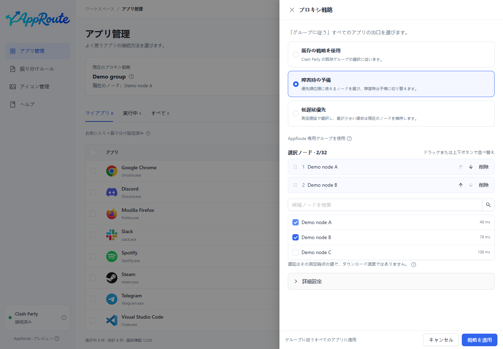
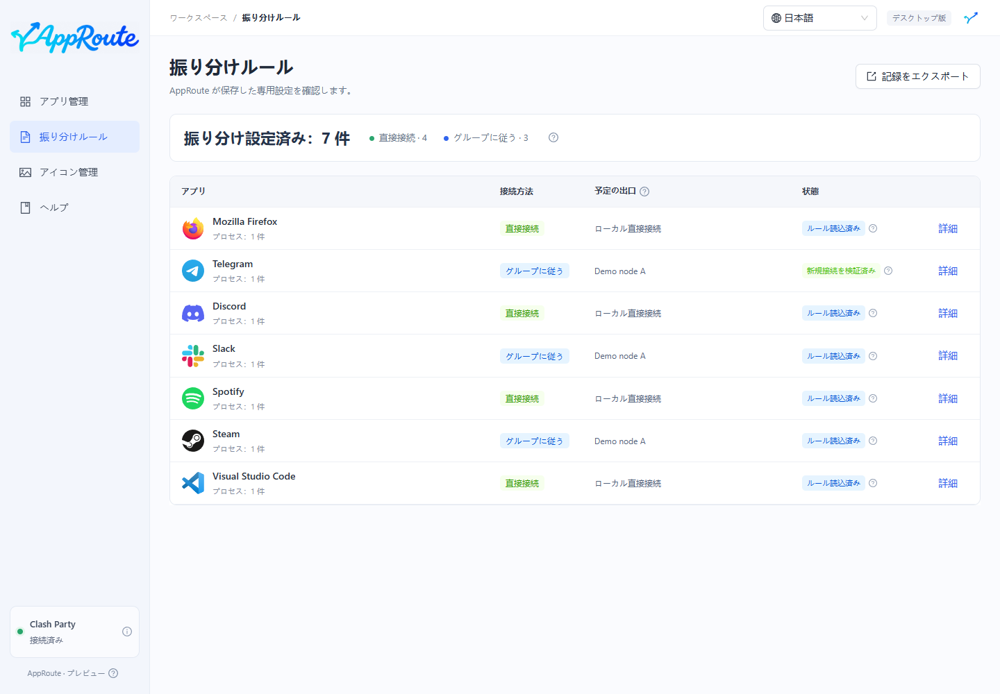
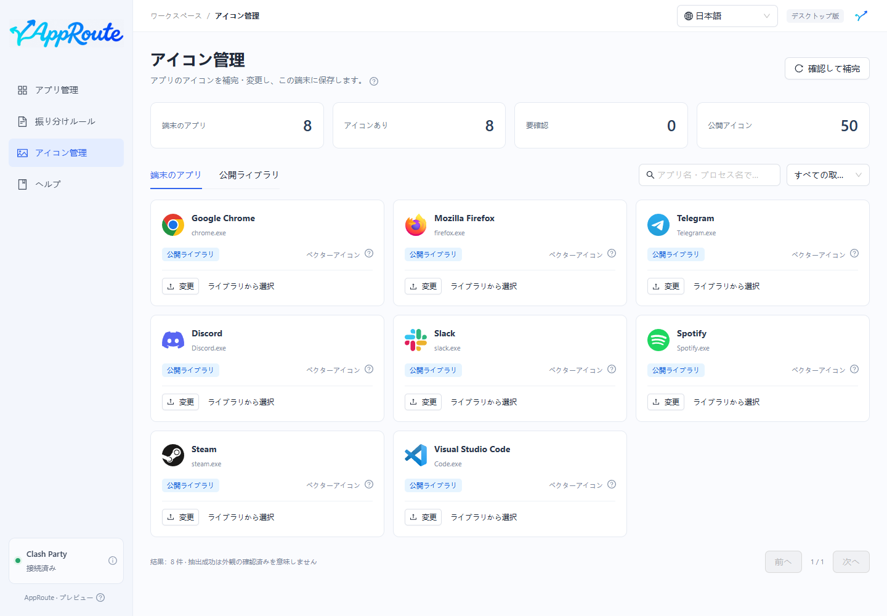
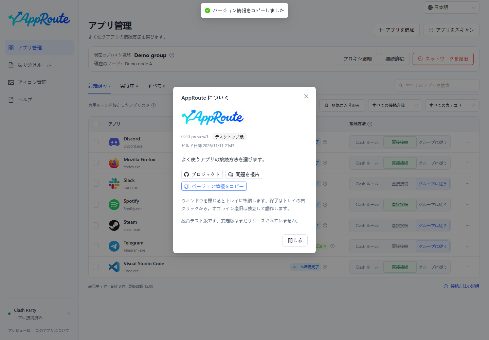

<strong>ルールを手書きせず、アプリごとに接続方法を選択。</strong>

<a href="README.md">简体中文</a> · <a href="README.en.md">English</a> · 日本語 · <a href="README.fr.md">Français</a>

  <a href="LICENSE">MIT</a>

[ダウンロード](#ダウンロード) · [クイックスタート](docs/guide/ja/quickstart.md) · [ドキュメント](https://yueyuyu.github.io/app-route/ja/) · [よくある質問](docs/guide/ja/faq.md) · [問題を報告](https://github.com/Yueyuyu/app-route/issues/new/choose)

AppRoute は端末のアプリを検出し、**Clash のルール・直接接続・グループに追従**を選択できます。ルールの読み込みと実際の新規接続を分けて確認します。設定済みの **Clash Party / Mihomo** が必要です。ノードやサブスクリプションは提供しません。

> **Windows はプレビュー版、macOS は実験版です。** 発行者署名、Apple 公証、自動更新はありません。Mac 実機での振り分けと復旧は未検証です。[対応範囲](docs/guide/ja/install.md#support)

## ダウンロード

<!-- downloads:ja:start -->
**現在のプレビュー版: [0.2.0-preview.2](https://github.com/Yueyuyu/app-route/releases/tag/v0.2.0-preview.2)**

| お使いのコンピューター | ダウンロード | サイズ | 検証 |
| --- | --- | --- | --- |
| Windows · Intel / AMD 64 ビット | [インストーラー EXE](https://github.com/Yueyuyu/app-route/releases/download/v0.2.0-preview.2/AppRoute-0.2.0-preview.2-setup-x64.exe) | 140.8 MiB | [SHA-256](https://github.com/Yueyuyu/app-route/releases/download/v0.2.0-preview.2/AppRoute-0.2.0-preview.2-setup-x64.exe.sha256) |
| Mac · Apple シリコン（実験版） | [DMG](https://github.com/Yueyuyu/app-route/releases/download/v0.2.0-preview.2/AppRoute-0.2.0-preview.2-mac-arm64.dmg) | 155.0 MiB | [SHA-256](https://github.com/Yueyuyu/app-route/releases/download/v0.2.0-preview.2/AppRoute-0.2.0-preview.2-mac-arm64.dmg.sha256) |
| Mac · Intel（実験版） | [DMG](https://github.com/Yueyuyu/app-route/releases/download/v0.2.0-preview.2/AppRoute-0.2.0-preview.2-mac-x64.dmg) | 161.6 MiB | [SHA-256](https://github.com/Yueyuyu/app-route/releases/download/v0.2.0-preview.2/AppRoute-0.2.0-preview.2-mac-x64.dmg.sha256) |

その他のファイル: [arm64 ZIP](https://github.com/Yueyuyu/app-route/releases/download/v0.2.0-preview.2/AppRoute-0.2.0-preview.2-mac-arm64.zip) · [x64 ZIP](https://github.com/Yueyuyu/app-route/releases/download/v0.2.0-preview.2/AppRoute-0.2.0-preview.2-mac-x64.zip). Mac ZIP はアプリの圧縮ファイルです。Source code はソースコードで、インストーラーではありません。

SHA-256 はファイルの整合性を確認します。発行者署名の代わりにはなりません。
<!-- downloads:ja:end -->

実行環境は同梱されています。**Node.js、ブラウザー、ビルドコマンドは不要です。** [インストールと検証](docs/guide/ja/install.md)

## 画面を見る

画像は実際の Electron 画面と隔離したデモデータを使用しています。操作例であり、実通信の検証結果ではありません。

プロキシ戦略、接続詳細、その他の画面

## できること

- **アプリ別に選択**：実際のアプリを検出し、全体検索、設定済み・実行中・お気に入りで絞り込めます。
- **クリックして適用**：連続変更は順番に処理・統合されます。確認に失敗した変更は元に戻します。
- **いつものグループに追従**：Clash Party でノードを変えると、新規接続が追従します。
- **自動戦略を選択**：既存グループ、優先順位によるフェイルオーバー、遅延優先を Mihomo が実行します。
- **オフライン復旧**：アプリ内と独立した復旧入口を用意し、既存のサブスクリプションとルールを維持します。
- **デスクトップで利用**：トレイ、アイコン管理、中国語・英語・日本語・フランス語。初回はシステム言語に従います。

## 接続方法

| 選択肢 | 識別され、Clash に取り込まれた新規接続の動作 |
| --- | --- |
| Clash のルール | Clash Party の既存ルールが直接接続かプロキシかを決めます。 |
| 直接接続 | DIRECT を使い、リモートのプロキシノードを経由しません。 |
| グループに追従 | 指定グループの選択・戦略を使います。DIRECT / REJECT が選ばれると直接接続・拒否になります。 |

既存接続は強制切断しません。Clash に入らない通信への適用は保証しません。TUN の有効化、システムプロキシの変更、他の VPN の終了を自動では行いません。

## 初めて使う

1. AppRoute をインストールし、設定済みの Clash Party をルールモードで起動します。
2. AppRoute の左下で内核への接続を確認します。
3. アプリを検索して「直接接続」を選びます。プロキシを使う場合は「プロキシ戦略」でグループを指定し、「グループに追従」を選びます。
4. 対象アプリで新しい通信を開始し、状態と詳細を確認します。青いルール準備完了は、すべての通信の検証完了を意味しません。

初回の覆写登録後は Clash Party を通常の方法で終了・再起動し、ルールが維持されるか確認してください。[詳しい手順](docs/guide/ja/quickstart.md)

## 目的から探す

[QQ Music を直接接続](docs/guide/ja/direct.md) · [グループに追従](docs/guide/ja/follow-group.md) · [フェイルオーバーと遅延](docs/guide/ja/strategies.md) · [更新・削除・復旧](docs/guide/ja/maintenance.md)

ネットワークに問題がある場合は「ネットワークを復旧」を使用します。アプリが開けない場合はデスクトップの **AppRoute - Restore Network** を使います。独立入口は初回のルール適用前に作成されます。AppRoute の専用設定を停止する機能であり、システム全体のリセットや他のソフトの障害修復を保証しません。[復旧手順](docs/guide/ja/maintenance.md#recovery)

## 開発と参加

通常の利用には上記のインストーラーを使用してください。開発者向けの `main` からのビルド手順は [貢献ガイド](CONTRIBUTING.md) にあります（中国語）。

[設計](docs/ARCHITECTURE.md) · [ロードマップ](docs/ROADMAP.md) · [検証記録](docs/VERIFICATION.md) · [翻訳](docs/LOCALIZATION.md) · [ブランド](docs/design/brand-lockup.md) · [第三者ライセンス](THIRD_PARTY_NOTICES.md)。技術文書は中国語です。

アプリ一覧、アイコン、管理記録は端末に保存します。報告前にサブスクリプション、認証情報、個人のパス、生ログを除いてください。独自コードは [MIT](LICENSE) ライセンスです。
