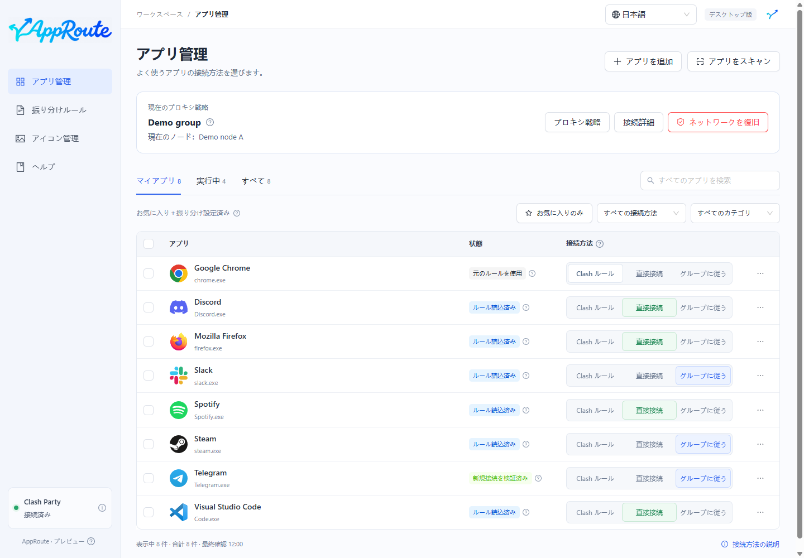
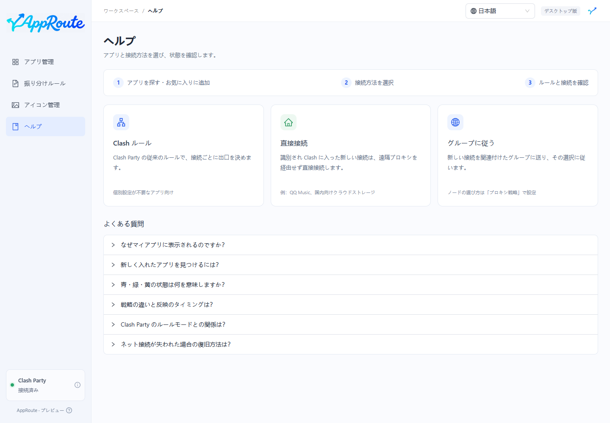

<p align="center"></p>
<p align="center"><strong>アプリごとに接続方法を選択。プロキシルールの手書きは不要です。</strong></p>
<p align="center"><a href="README.md">简体中文</a> · <a href="README.en.md">English</a> · 日本語 · <a href="README.fr.md">Français</a></p>

AppRoute は **Clash Party / Mihomo** と連携する Windows デスクトップアプリです。端末のアプリを検出し、**Clash ルール・直接接続・グループに従う**から選択できます。ルールの読み込みと実際の接続の検証は別々に表示します。

> **0.2.0-preview.1 · 統合テスト版。** ローカルでのビルド・インストールに対応しています。署名付きインストーラーと自動更新は未提供です。実クライアントの再起動、サブスクリプション切り替え、スリープ、全互換性の検証は未完了です。

## 画面を見る



実際の Electron UI を、**架空のパス・グループ・接続記録**で撮影しています。画面の紹介であり、実ネットワークの検証結果ではありません。

<details><summary>プロキシ戦略・ルール・アイコン・ヘルプ</summary>




</details>

## 主な機能

- **クリックで適用**：連続操作の待ち行列、互換性のある変更の統合、失敗時の自動復元。
- **アプリの検出**：自動スキャン、exe の手動選択、実行中フィルター、システムツールの折りたたみ。マイアプリは「お気に入り＋専用設定済み」で、使用頻度は計測しません。
- **グループに追従**：普段使うグループを一度関連付けると、新規接続がグループ内の変更に従います。
- **3 種類の戦略**：既存グループ、優先順位による障害時の予備、測定遅延による選択。自動選択は Mihomo が実行します。
- **状態を確認**：青はルール読込済み、緑は設定に一致する新規接続の観測済み。現在の選択と実際の接続先を区別します。
- **デスクトップとトレイ**：閉じるとトレイに格納。終了後も確定済みルールは維持。独立したオフライン復旧を同梱。
- **アイコン管理**：端末からの抽出、50 個の公開アイコン、既定画像、ユーザー画像を利用し、端末に保存。
- **4 言語対応**：簡体字中国語・英語・日本語・フランス語。右上の選択を保存します。

## 接続方法の違い

| 選択肢 | 新しい接続の処理 |
| --- | --- |
| Clash ルール | Clash Party の従来のルールが直接接続かプロキシを決定します。 |
| 直接接続 | 識別され Clash に取り込まれた接続を DIRECT で処理し、遠隔プロキシを経由しません。 |
| グループに従う | 関連付けたグループの選択または自動戦略を使います。DIRECT／REJECT は直接接続／拒否です。 |

ノードやサブスクリプションの提供はありません。Clash を通らない通信への適用は保証しません。既存接続の強制切り替え、TUN の自動有効化、システムプロキシの自動変更は行いません。[互換性と制約](docs/COMPATIBILITY.md)（中国語）

## 使い始める

検証した構成は **Windows、Clash Party 2.0.4、Mihomo v1.19.32** のルールモード・安定版内核です。他のクライアントは未対応です。Node.js 24 LTS（24.11 以降の 24.x）でビルドします。

```powershell
git clone https://github.com/Yueyuyu/app-route.git
cd app-route
git switch codex/clash-party-recovery
npm ci
npm run desktop:build
npm run desktop:install
```

1. Clash Party を起動し、デスクトップの AppRoute を開きます。
2. 「プロキシ戦略」で普段使うグループを選び、適用します。
3. アプリを探して接続方法を選び、状態を確認します。
4. 初回登録後は Clash Party を正常終了して開き直し、ルールが残ることを確認します。

インストール後はブラウザー・開発サーバー・別の Node は不要です。初回の言語はシステムに従い、未対応の場合は簡体字中国語になります。右上から変更できます。[デスクトップ版](docs/DESKTOP.md)（中国語）

## オフラインでも復旧

適用失敗時は変更を戻します。未確定のトランザクションは独立した **120 秒の監視プロセス**で保護します。アプリの「ネットワークを復旧」、またはデスクトップの **AppRoute - Restore Network** を使えます。ネット接続や ChatGPT は不要です。

AppRoute 所有のルールと専用自動グループを無効にし、元の設定を維持します。外部の障害の修復は保証しません。シャットダウン・スリープ・監視自体の停止は検証が残っています。[復旧の詳細](docs/RECOVERY.md)（中国語）

## ブランドとデザイン

<p> </p>

アプリ内は青緑から青へのグラデーションで、左右非対称の分岐矢印を A に自然につないだ一体ロゴです。副題は表示しません。デスクトップは確定済みの濃いグレーブルーの角丸背景を使います。Ant Design の画面では要約と詳細説明を分けます。

[一体ロゴ](docs/design/brand-lockup.md) · [アイコン](docs/design/app-icon.md) · [字標](docs/design/wordmark.md) · [UI 方針](docs/design/README.md) · [素材ライセンス](THIRD_PARTY_NOTICES.md)（中国語）

## 開発・参加

```powershell
npm run dev          # 開発用プレビュー
npm run check        # テスト・型検査・ビルド
npm run check:i18n   # Windows：隔離デスクトップでの言語検証とデモ撮影
```

言語変更で振り分け・アプリ識別子・パス・ノード名は変わりません。未分類の技術診断は原文を保持し、独立復旧コマンドラインは現在中国語です。[翻訳の保守](docs/LOCALIZATION.md) · [構成](docs/ARCHITECTURE.md) · [計画](docs/ROADMAP.md) · [検証記録](docs/VERIFICATION.md) · [貢献ガイド](CONTRIBUTING.md)（中国語）

一覧・お気に入り・アイコン・管理記録は端末に保存します。[問題を報告](https://github.com/Yueyuyu/app-route/issues)する前に、認証情報・サブスクリプション・個人パスを除去してください。自有コードは [MIT](LICENSE)、第三者素材と商標の権利は別途留保されます。
