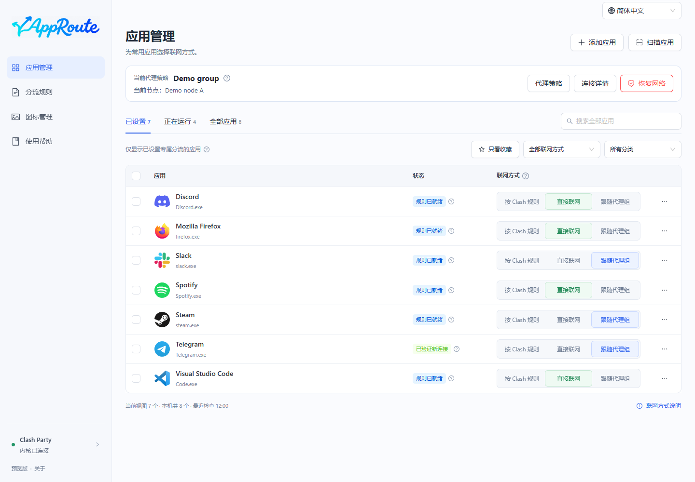
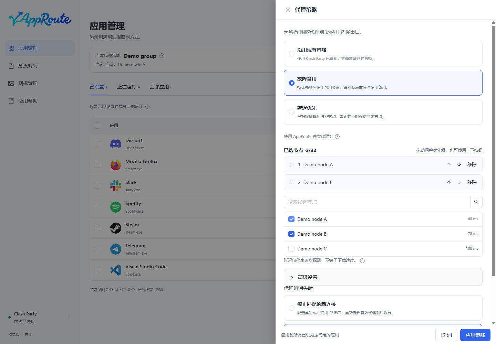
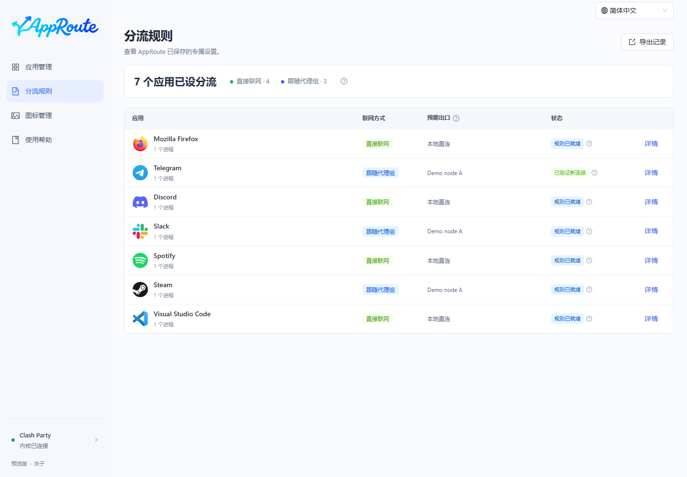
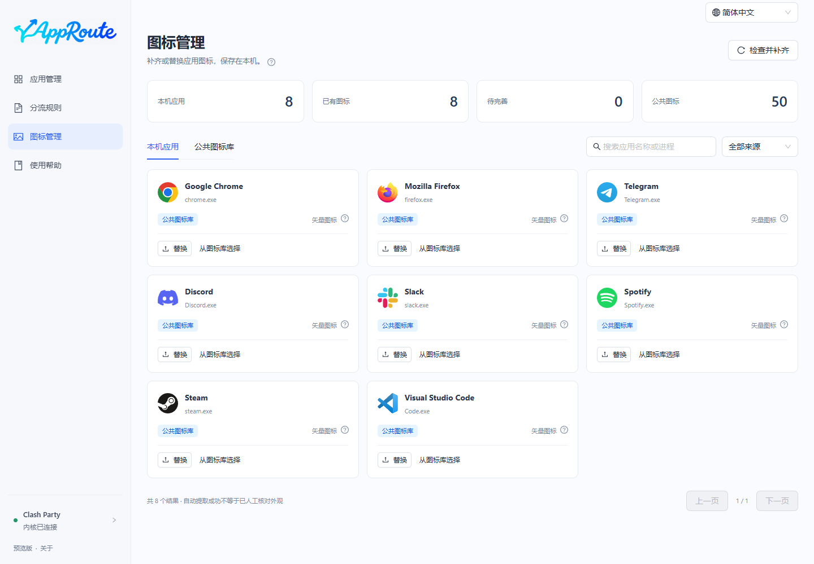
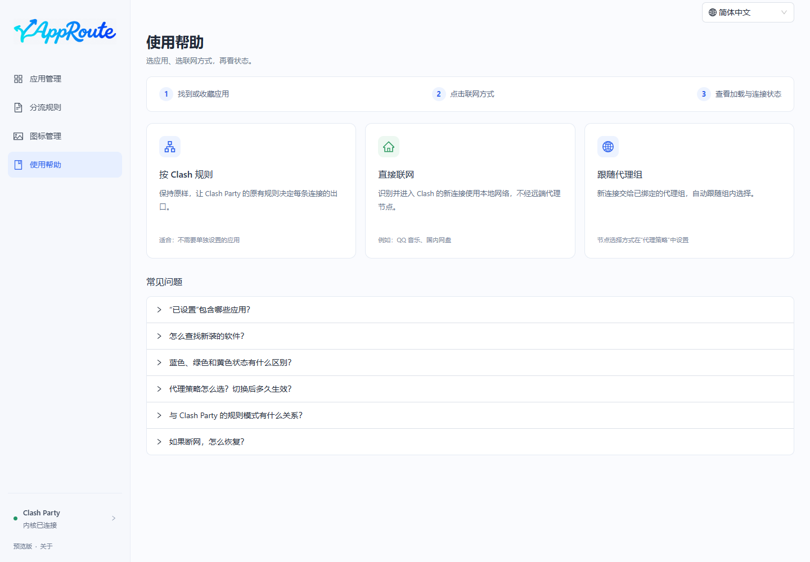
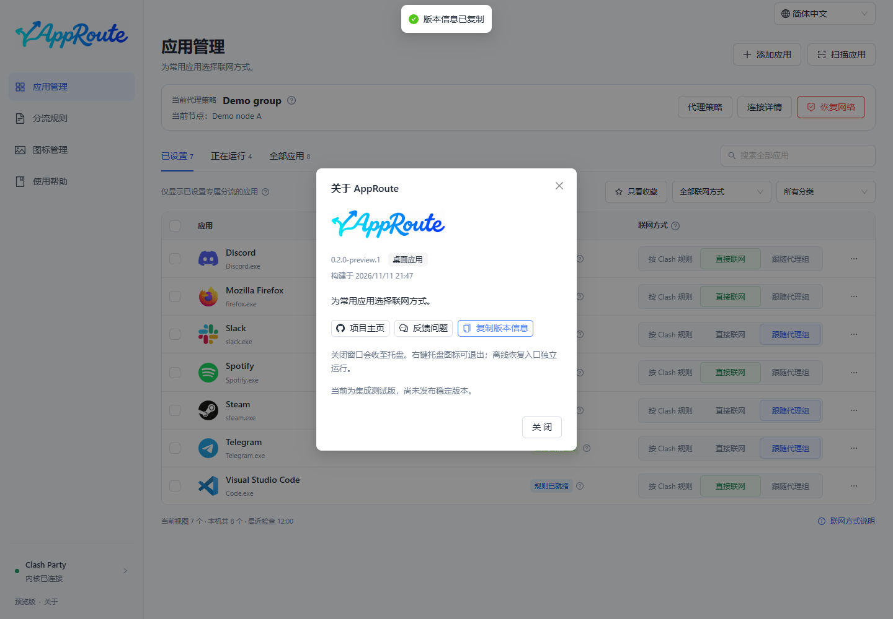

<strong>为每个应用选择联网方式，无需手写代理规则。</strong>

简体中文 · <a href="README.en.md">English</a> · <a href="README.ja.md">日本語</a> · <a href="README.fr.md">Français</a>

   

AppRoute 是一个桌面应用（Windows 预览版，macOS 实验性预览版）：扫描本机软件，为应用选择 **按 Clash 规则、直接联网或跟随代理组**，并显示规则加载与实际连接的验证状态。当前配合已有的 Clash Party / Mihomo 使用。

> **0.2.0-preview.1 · 预览版，非稳定版。** 提供 Windows x64、macOS Apple Silicon 和 Intel 构建流程。本机 Windows 已验证正常重启与两份真实订阅往返切换；远程订阅刷新、整机睡眠及 Mac 真实分流仍待验收。安装包尚无发布者签名或 Apple 公证，也没有自动更新。

[预览版下载](https://github.com/Yueyuyu/app-route/releases) · [Mac 支持范围](docs/MACOS.md) · [验收记录](docs/VERIFICATION.md)

## 看看界面

截图来自真实 Electron 界面，使用虚构的应用路径、代理组与连接记录，**仅展示交互，不作为真实网络生效证据**。

代理策略、分流规则、图标管理与使用帮助

## 可以做什么

| 功能 | 使用方式 |
| --- | --- |
| 按应用分流 | 点击联网方式自动应用；连续选择可排队、合并，失败自动回退。 |
| 自动发现软件 | 启动、返回窗口及定时检查新应用；支持手动选择 Windows exe / Mac 应用包、运行中筛选和系统工具折叠。 |
| 已设置 | 只收录直接联网或跟随代理组的应用；收藏独立筛选，搜索覆盖全部应用。 |
| 跟随代理组 | 统一绑定 Clash Party 中常用的组；组内换节点后，新连接自动跟随。 |
| 三种代理策略 | 沿用已有组、按优先级故障备用、按探测延迟选择；自动策略由 Mihomo 执行。 |
| 状态可核对 | 蓝色“规则已就绪”表示规则已加载、还没有新连接证据；绿色表示已观察到符合设置的新连接；组当前选择与实际连接分别显示。 |
| 桌面与托盘 | 双击快捷方式打开；关闭窗口收至托盘，退出后已确认规则继续保留。 |
| 图标管理 | 本机提取、50 个公共图标、默认图标与自定义替换；素材留在本机。 |
| 四种显示语言 | 简体中文、English、日本語、Français；右上角切换，自动保存。 |

## 本轮完善

- 启动、唤醒和后台定时核对未完成事务，内核离线时保留待恢复记录。
- 代理组消失时，可明确选择拒绝匹配的新连接或沿用原规则；旧设置保持原行为。
- 新发现标记保留七天；收藏只筛选，不自动设置网络。
- 详情拆成连接概况、应用规则、恢复与诊断，提供阶段耗时和脱敏导出。
- 管理记录丢失或损坏时，先核对脚本、磁盘标记和运行规则，再只恢复记录；保留本机原文备份。
- 可构建用户级 NSIS 安装器与校验文件，升级保留数据。仍未签名，也没有自动更新。

[六项改进与验收边界](docs/MATURITY-PLAN.md)

## 三种联网方式

| 选项 | 新连接如何处理 |
| --- | --- |
| 按 Clash 规则 | 沿用 Clash Party 的原有规则，可能直连，也可能代理。 |
| 直接联网 | 被识别并进入 Clash 的连接使用 DIRECT，不经过远端代理节点。 |
| 跟随代理组 | 交给已绑定组的当前选择或自动策略；组选择 DIRECT / REJECT 时也会相应直连或拒绝。 |

AppRoute 不提供代理节点或订阅。未进入 Clash 的流量无法保证按这些设置分流；已有连接不会强制切换。默认保留原有规则，不自行启用 TUN、修改系统代理或关闭其他 VPN。[详细边界](docs/COMPATIBILITY.md)

## 开始使用

当前验证组合为 **Windows + Clash Party 2.0.4 + Mihomo v1.19.32**，使用规则模式与稳定内核。其他客户端尚未接入。

目前从源码构建，需要 Node.js 24 LTS（24.11 或更新的 24.x）：

~~~powershell
git clone https://github.com/Yueyuyu/app-route.git
cd app-route
git switch codex/clash-party-recovery
npm ci
npm run desktop:build
npm run desktop:install
# 或生成用户级安装器：npm run installer:build
~~~

1. 启动 Clash Party，再双击桌面的 AppRoute。
2. 在“代理策略”中选择常用组，点击“应用策略”。
3. 搜索应用，选择“直接联网”或“跟随代理组”，查看该行状态。
4. 首次登记覆写后，正常退出并重新打开一次 Clash Party，再核对规则是否保留。

安装后的桌面版自带运行时，不需要浏览器、开发服务器或另装 Node。首次语言跟随系统；不支持时使用简体中文。右上角可随时改为固定语言或恢复跟随系统。[桌面使用与数据位置](docs/DESKTOP.md)

## 断网也能恢复

- **应用失败**：撤销本次修改；未完成确认的事务由独立的 120 秒守护兜底。
- **应用仍可打开**：点击“恢复网络”，停用 AppRoute 专属规则与专用自动代理组。
- **应用打不开**：双击桌面的 **AppRoute - Restore Network**，无需网络、ChatGPT 或项目目录。

恢复保留原有订阅、规则和系统网络设置。它撤销 AppRoute 引入的改动，不承诺修复外部网络故障；关机、休眠和守护自身退出仍是待验收场景。[恢复范围与限制](docs/RECOVERY.md)

## 品牌与设计

| 应用内组合标志 | 桌面、窗口与托盘图标 |
| :---: | :---: |
|  |  |

应用内采用青蓝渐变的同笔连接标志：分叉箭头与 A 自然相接，保留左低右高的非对称造型，不再显示中文副标题。桌面采用 02 深灰蓝圆角底，保证独立辨识度。页面使用 Ant Design，摘要与详细说明分层展示。

[组合标志](docs/design/brand-lockup.md) · [图标规范](docs/design/app-icon.md) · [字标沿革](docs/design/wordmark.md) · [界面约定](docs/design/README.md) · [公共素材许可](THIRD_PARTY_NOTICES.md)

## 开发与参与

~~~powershell
npm run dev          # 仅开发预览
npm run check        # 自动测试、类型检查和构建
npm run check:i18n   # Windows：隔离桌面四语验收及演示截图
~~~

语言切换不改变分流设置、应用身份或节点名称。翻译、界面截图的更新方式见 [多语言维护](docs/LOCALIZATION.md)；未知的技术诊断保留原文，独立离线恢复命令行暂保留中文。

[项目定位](docs/PROJECT.md) · [架构](docs/ARCHITECTURE.md) · [路线图](docs/ROADMAP.md) · [验证记录](docs/VERIFICATION.md) · [贡献指南](CONTRIBUTING.md) · [报告问题](https://github.com/Yueyuyu/app-route/issues)

应用清单、收藏、图标和管理记录保存在本机。提交问题时请移除订阅、密钥、个人路径和原始诊断。自有代码使用 [MIT](LICENSE)；第三方素材许可与商标权分别保留。
