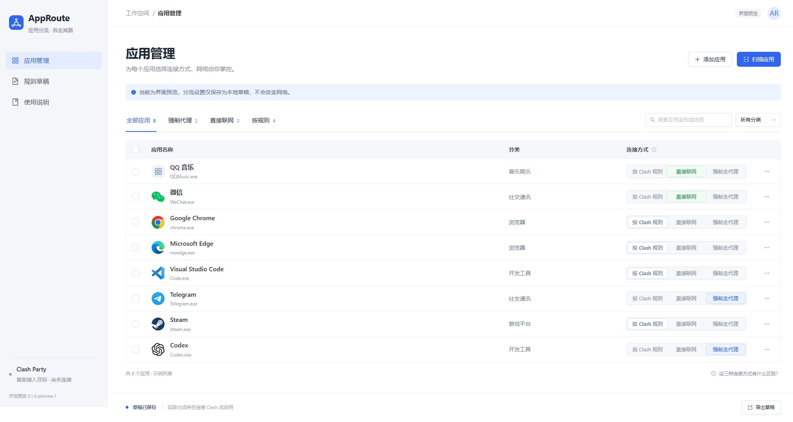

# AppRoute 应用分流

为每个应用选择联网方式：按现有规则、直接联网或使用指定代理出口。

**当前版本：`0.1.0-preview.1`，可运行的开发预览。** 已有 Ant Design 界面、Windows 本机只读应用扫描和本地草稿管理；尚未接入任何代理内核，不会改变实际网络。首个正式集成目标是 Clash Party，架构同时为其他内核和客户端保留接入边界。

## 当前可以做什么

- 搜索、分类、筛选应用，批量设置三种联网方式。
- 扫描开始菜单、安装登记和有可见窗口的进程；手动添加应用及子进程。
- 查看应用详情，将选择保存到浏览器本地，导出设置草稿。
- 阅读三种联网方式的说明。初始八个应用均为示例，扫描后才有真实本机数据。

草稿不是可直接导入 Clash 的配置。导出中的 `applied: false`、`proxyProvider: null` 和 `proxyGroup: null` 表明尚未接入实际执行端。



## 本地运行

需要 Node.js 24 LTS（24.11 或更新的 24.x）和 npm。界面可在其他桌面系统预览；本机扫描只支持 Windows。

```sh
git clone https://github.com/Yueyuyu/app-route.git
cd app-route
npm ci
npm run dev
```

打开 <http://127.0.0.1:4318/>。开发预览仅监听本机；使用固定端口以校验扫描请求来源。

```sh
npm run check    # 测试、TypeScript 检查和生产构建
npm run preview  # 构建完成后的本机预览，同样使用 4318 端口
```

开发服务器和构建预览不能同时占用 4318。纯静态部署只能预览界面、编辑草稿，不能调用 Windows 扫描。当前没有 Electron 安装包，也没有开机后台服务。

## 为什么不只支持一个 Clash 客户端

AppRoute 将应用策略、内核运行控制、客户端配置持久化分别管理。

| 接入路线 | 作用 | 当前状态 |
| --- | --- | --- |
| Mihomo + Clash Party 配置适配 | 使用内核进程规则，由客户端保存长期配置 | 首版计划，尚未实现 |
| Mihomo + 其他客户端 / 独立配置 | 复用运行控制，分别处理配置生命周期 | 后续规划，尚未验证 |
| sing-box | 使用独立的规则与配置适配 | 候选路线，尚未实现 |
| HTTP / SOCKS5 端口 + 流量接管组件 | 把指定应用的流量送入通用代理端口 | 技术预研，尚未实现 |

**代理端口只是入口，不会自动让指定软件使用它。** 通用端口路线仍需要流量接管能力；端口可用不代表支持进程规则、UDP、远端节点强制出口或可靠的直接联网。具体见 [兼容性设计](docs/COMPATIBILITY.md)。

## 项目资料

- [项目基础说明](docs/PROJECT.md)：定位、术语、范围与验收标准。
- [架构和目录职责](docs/ARCHITECTURE.md)：前后端边界、适配层、配置生命周期。
- [功能规划](docs/ROADMAP.md)：分阶段目标与完成状态。
- [开发规则](AGENTS.md)：修改代码和配置时必须保持的约定。
- [贡献指南](CONTRIBUTING.md)、[设计约定](docs/design/README.md)、[验证记录](docs/VERIFICATION.md)。

## 数据与许可

应用草稿保存在当前浏览器的 localStorage，键为 `approute.draft.v1`；清除站点数据会删除草稿。不同端口的预览数据互相独立，旧原型的浏览器草稿不会自动迁移。

扫描会在本机读取应用名称、进程名、程序位置、发布者和图标。导出的完整草稿可能包含个人程序路径，不适合直接作为公开问题附件。代码不提供遥测或云端上传功能。

自有代码采用 [MIT License](LICENSE)。第三方组件和品牌图标的来源见 [THIRD_PARTY_NOTICES.md](THIRD_PARTY_NOTICES.md)。本仓库当前不分发代理内核或流量接管驱动。
