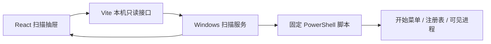
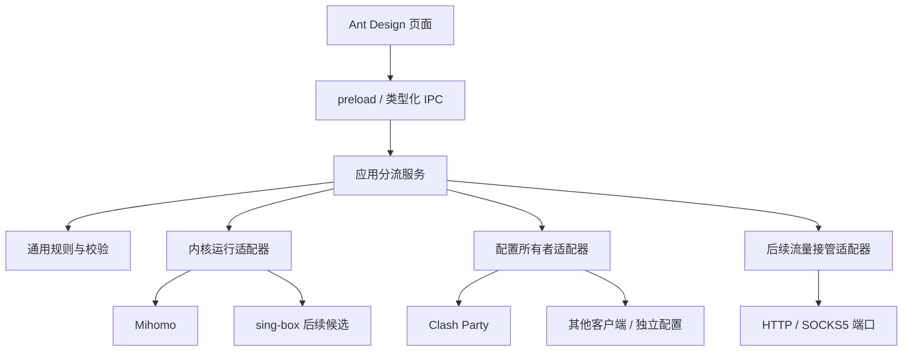

# 架构与目录职责

## 决策

采用单仓库、TypeScript、React、Ant Design。目标运行形态为 Electron 桌面应用，前端和本机程序按职责分离，通过受限 IPC 通信，不依赖云服务。

**当前实际运行形态仍是 Vite 本机预览。** `src/main` 已迁入可复用的 Windows 扫描实现，但没有 Electron 入口；`src/preload` 目前仅有边界说明。不能把目录名视为桌面化已完成。

Electron 选择理由：复用现有 React/TypeScript 原型及 Node 本机能力，减少首版语言和工具链数量。安装包大小和后台资源占用在桌面化阶段测量；本阶段不承诺具体体积。

## 当前目录

| 路径 | 职责与依赖 |
| --- | --- |
| `src/renderer/App.tsx` | 导航、页面组合、筛选、抽屉及批量操作 |
| `src/renderer/components` | 应用表格、编辑、扫描、路由选择器、草稿和说明页 |
| `src/renderer/hooks` | 浏览器草稿读取、保存与更新 |
| `src/renderer/data` | 纯示例数据，不放本机扫描结果 |
| `src/renderer/types.ts` | 当前界面标签、分类及类型入口；客户端相关文案留在界面层 |
| `src/shared` | 应用数据、扫描结果和执行端类型，无 I/O 或 UI 依赖 |
| `src/core` | 与客户端品牌无关的业务规则；目前为进程输入校验 |
| `src/main/platform/windows` | 固定 PowerShell 脚本及扫描调用，输出结构化本机数据 |
| `src/main/adapters` | 内核、配置所有者、流量接管的类型契约；目前无具体适配器 |
| `src/preload` | 后续 Electron 有限 IPC 接口的边界说明 |
| `tooling/vite` | 开发预览的只读 HTTP 桥接、Host/Origin 校验 |
| `public` | 网站图标及许可来源明确的品牌 SVG |
| `scripts` | 可重复生成资源等开发脚本 |
| `tests` | 业务输入约束、扫描请求边界和异常脱敏测试 |
| `docs` | 产品、架构、兼容性、路线图和验证记录 |
| `.github` | Windows CI 与问题模板 |

按实际功能增加 `src/main/services`（完整应用流程）、`storage`（设置/迁移/备份）、`desktop`（窗口/托盘）、`src/renderer/features`（业务变大后的页面组织）和 `resources`（安装包资源）。不预先堆放无实现的占位模块。

## 当前扫描链路

接口为 `GET /api/applications`，仅本机 4318 端口、指定请求头及同源请求可访问；结果禁止缓存。同一轮并发扫描复用任务，25 秒超时。执行过程不启动扫描到的 EXE，不读取窗口标题。

## 正式分流架构（待实现）

三类适配器各自声明探测结果，不通过软件名猜测能力：

1. **EngineRuntimeAdapter**：探测内核版本、运行模式、控制接口与可观察能力。后续扩展代理组、连接和重载等操作。
2. **ConfigurationOwnerAdapter**：确认长期配置归属，处理持久化、订阅刷新、配置切换和恢复。即使多个客户端使用相同内核，也可能需要不同实现。
3. **TrafficInterceptorAdapter**：通用端口路线的进程识别与流量接管。首版不引入额外接管组件；能力契约不代表已安装驱动。

UI 读取能力和状态，展示对应选项。HTTP/SOCKS5 端口地址与内核控制 API 地址是不同配置项；API secret 不进入 renderer 或草稿。

## 写入协议（实现前须验证）

读取拥有者配置及版本指纹 → 生成 AppRoute 管理的差异 → 校验与预览 → 备份 → 再查并发变更 → 原子写入 → 重载 → 核验配置 → 观测新连接。

若中途失败，记录阶段并恢复自己的改动；恢复前同样检查是否有其他写入。不得把旧备份直接覆盖用户的新配置。核心服务串行管理写入，同一份业务规则不在多个模块各维护一套。

客户端持久化适配优先使用其明确支持的覆写/扩展机制。不能仅修改临时生成的运行配置；不能替换用户已有的完整覆写脚本。API 支持运行修改不代表订阅刷新后会保留。

## 状态与存储

草稿状态、配置应用状态、连接观测状态分别建模。例如“已保存 / 待应用”“已应用 / 失败”“检测到直连 / 检测到代理 / 尚无新连接”。当前预览只实现草稿状态。

正式桌面版计划：普通设置存用户数据目录，敏感凭据存本机安全存储，仅保留引用；备份与日志按限额保留，导出诊断时脱敏。不得在仓库中提交运行数据。

## 参考

- [Electron 进程模型](https://www.electronjs.org/docs/latest/tutorial/process-model)
- [Electron 安全建议](https://www.electronjs.org/docs/latest/tutorial/security)
- [Mihomo API](https://wiki.metacubex.one/api/)
