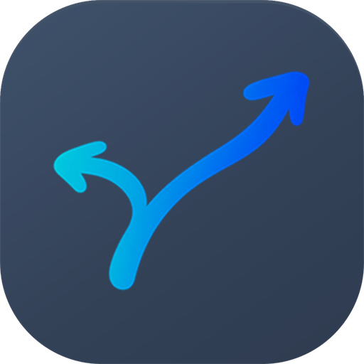

# AppRoute 应用图标

当前应用左上角与小屏导航使用 [同笔连接组合标志](brand-lockup.md)，已去掉中文副标题。侧栏融合调整移除了右上角重复的独立透明箭头，原资产保留；02 深灰蓝图标继续用于桌面、窗口和托盘，资产不变。以下右上角使用说明保留为此前阶段记录，当前用途以本段及界面约定为准。

2026-11-11，用户要求去掉应用内图标外围像阴影的浅蓝包边：**应用内直接使用透明箭头，无包边或阴影；桌面继续使用 02「适中提亮」深灰蓝底，艺术字保持不变。**

两者共用同一张青蓝渐变的手写分流箭头：左支较短，向左上展开；右支较长，向右上展开。固定原有笔势、箭头方向和非对称比例，仅外围处理不同。

## 文件与用途

| 文件 | 用途 |
| --- | --- |
| `resources/brand/app-icon/brush-routing-source.png` | GPT 生成的原始箭头，原文件完整保留 |
| `resources/brand/app-icon/route-glyph.png` | 组合评审使用的同一张 256px 透明箭头 |
| `resources/brand/app-icon/approved.json` | 两种外观的精确参数、用户决定、原图与字标哈希 |
| `resources/brand/app-icon/source.json` | 原始箭头的实际生成提示词和来源 |
| `public/brand/app-route-inline.svg` | 应用内透明箭头，无包边或阴影，当前用于顶部栏；导航改用一体组合 |
| `public/brand/app-route.png` | 02 深灰蓝桌面主图，1024px，圆角外透明 |
| `public/brand/app-route-32.png` | 浏览器标签页图标 |
| `public/brand/app-route-128.png` | README 等独立品牌展示 |
| `public/brand/app-route-180.png` | Apple touch icon |
| `public/brand/app-route-512.png` | 独立图标展示及后续桌面打包 |
| `public/favicon.ico` | 浏览器及 Windows 图标，含 16、24、32、48、64、128、256px 七帧 |
| `public/brand/app-route-wordmark.png` | 已确认的艺术字原文件，此次不修改 |

应用内示意：


桌面图标：



## 固定参数与再导出

参数以 `approved.json` 为准。应用内 SVG 只内嵌原始 PNG，避免独立图片无法加载外部引用；不添加轮廓膨胀、模糊、包边或阴影。原箭头与 8% 内留白保持不变。桌面保留 28% 圆角、8% 内留白，145° 渐变依次为 `#3f526b`、`#334157`、`#2e3b4f`，停点为 0%、60%、100%。这些桌面参数来自已确认的 02 适中提亮预览。

Windows 上执行：

```sh
npm run icons:app
```

`scripts/render-app-icon.ps1` 先核对箭头和字标哈希，导出应用内 SVG、合成桌面 PNG；`scripts/export-app-icon.ps1` 再缩放并封装多尺寸 PNG / ICO。使用系统 System.Drawing，不依赖额外图像生成或 npm 图片库。不会重新生成、重绘或改色箭头，也不会修改艺术字；桌面外投影由使用场景提供，不烘焙进图标的透明外角。

## 品牌组合与桌面边界

`Brand.tsx` 当前使用一体组合图片，具体显示视窗与宽度见 [组合标志](brand-lockup.md)，不再单独叠放箭头或显示中文副标题。顶部栏继续使用透明箭头。浏览器标签页与桌面独立入口使用深灰蓝底。

本次本机验证使用了桌面 `AppRoute` 快捷方式，引用导出的 ICO，并打开 `http://127.0.0.1:4318/`；它依赖本机预览服务运行，不是 Electron 安装包。这是历史预览验证。2026-11-10 桌面版安装已把 AppRoute 入口改为独立 AppRoute.exe；窗口、托盘和快捷方式继续使用本稿的深灰蓝 ICO。独立网络恢复入口保持原样。

## 设计过程

先确认与连笔艺术字相近的手写分流箭头，再比较透明、浅冰蓝、深灰蓝和其他浅色底。深灰蓝 02 单独展示获得认可，与字标组合后仍显厚重；随后比较玻璃薄框、局部柔光、随形轮廓。2026-11-10 用户选择按场景使用：应用内随形、桌面深灰蓝。2026-11-11 用户认为应用内随形包边像一层多余的阴影，要求去掉；因此只移除 SVG 滤镜，不重绘箭头、不改色或调整尺寸。

旧的浅蓝底白色 / 薄荷绿图标保留在 Git 历史中，不再作为当前定稿。上述资源属于 AppRoute 自身品牌，与 `public/icons` 中的第三方应用标识分开管理。

## 去除应用内包边验证（2026-11-11）

- 去掉 SVG 的轮廓膨胀、模糊与合成滤镜，导出脚本同步调整，避免重新导出时恢复包边。
- 原箭头和艺术字哈希仍与定稿相同；桌面 PNG / ICO 未变化。
- 类型检查、恢复工具、页面与桌面打包通过。正常退出并更新本机桌面版后重新打开，实测侧栏与顶部栏显示无包边箭头，与原艺术字正常搭配；安装资源哈希与源码一致。

## 历史验证（2026-11-10）

- 艺术字 SHA-256 保持不变，与定稿记录一致。
- `npm run check` 通过：34 项测试、类型检查、恢复工具打包和页面构建；保留既有 bundle 体积提示。
- 实际应用页面已确认侧栏与顶部栏使用随形 SVG，图片成功加载；桌面目录已实际观察到深灰蓝 ICO。
- 网络恢复快捷方式写入前后哈希一致，未执行网络配置变更。
