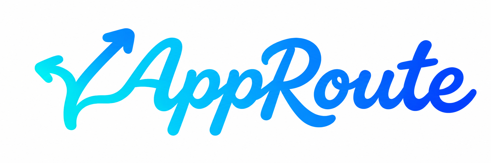

# AppRoute 应用内组合标志

2026-11-11，用户确认「同笔连接」的纵向舒展版本，并要求去掉“应用分流 · 各走其路”，替换应用左上角图标与艺术字。桌面图标继续使用 02 深灰蓝底。

## 固定特征

- 分叉箭头保持左低右高，保留非对称方向；不能为了对齐而改成等高箭头。
- 图标上下舒展，尾部接近两个 p 的下沿，减少图标下方的空洞。
- 箭头与 A 顺笔相接；圆润连笔、青蓝渐变与中等笔画重量保持统一。
- 不显示中文副标题。图标与艺术字作为一张图片使用，不拆分缩放或再加独立图标。

## 资产与实现

- `resources/brand/lockup/approved-preview.png`：用户选定的完整预览原文件。
- `resources/brand/lockup/approved.json`：选择记录、固定特征、原图与生产素材哈希。
- `resources/brand/lockup/prepare-prompt.txt`：内置图像工具的实际素材整理提示词。
- `public/brand/app-route-lockup.png`：通过内置 image_gen 从确认稿整理的白底单份标志，2172 × 724；不是字体文件或 SVG 描边重绘。
- `src/renderer/components/Brand.tsx`：桌面侧栏与小屏导航共用的一体标志；SVG viewBox 仅收起原图四周空白。
- `src/renderer/styles.css`：浅色导航以 `mix-blend-mode: multiply` 融合白底。当前普通侧栏标志宽度上限 184px，窄侧栏 160px，抽屉导航 184px；品牌区高 80px，左右约 24px 留白，与菜单图标形成对齐关系。

当前生产素材为白底图，未将透明抠图草稿用于界面；深色主题需另行验证。原独立艺术字和箭头资产保留供历史对照，来源与通用风格仍见 [艺术字规范](wordmark.md)。

## 使用边界

应用导航沿用确认组合原图，不运行独立图标再导出脚本。2026-11-11 的侧栏融合调整仅改变显示留白、对齐和侧栏宽度，并移除右上角重复的独立箭头；桌面快捷方式、窗口、托盘、浏览器图标保持不变。后续修改须从此确认稿开始，不能重新套用旧的图标加字标双列结构或恢复副标题。

## 验证（2026-11-11）

- `npm run check` 通过：76 项测试、类型检查、恢复工具与页面构建。保留既有 bundle 体积提示。
- 桌面打包与本机安装完成。正常退出后重新打开真实桌面应用，已观察到完整一体标志、无副标题、读屏名称 AppRoute；真实窗口截图保存在本机忽略目录 `.runtime/brand-lockup-verification/desktop-normal.png`。
- 隐藏的隔离 Electron 窗口加载同一构建产物，检查 1000px 与 1440px 内容宽度：标志分别为 168px、186px，比例保持、图片加载正常、没有超出侧栏。此项仅验证布局，不连接真实分流后台。
- 原桌面 ICO、1024px/512px 深灰蓝图标和历史独立字标的 SHA-256 前后相同；安装后的组合图片与源码哈希一致，安装后的 ICO 仍与原桌面图标相同。
- 本次没有修改分流逻辑或提交网络操作；未重新执行真实分流/恢复验收。
