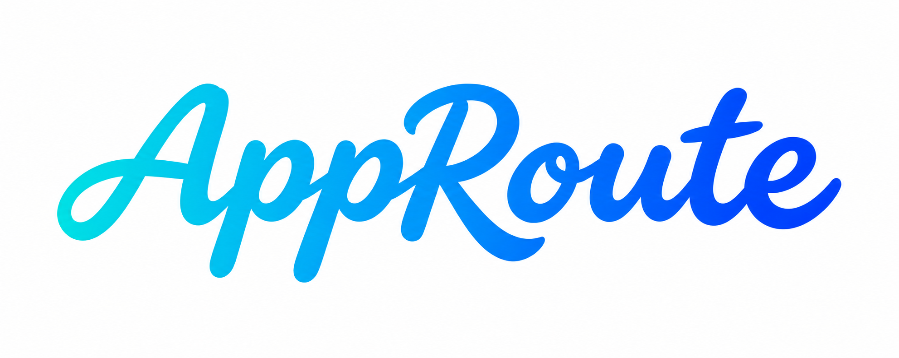

# AppRoute 艺术字与组合沿革

当前应用导航已切换为 2026-11-11 用户确认的 [同笔连接组合标志](brand-lockup.md)，图标与艺术字一体显示，去掉中文副标题。下文记录 2026-11-10 的独立字标定稿与通用风格来源；原资产保留，不再作为导航组件的当前来源。

2026-11-10，用户确认在圆润连笔稿基础上小幅收细的这一版，并授权接入应用页面。字标为图片，不是可安装字体。

## 原图与使用

- 文件：`public/brand/app-route-wordmark.png`，1983 × 793 像素，白底青蓝渐变。
- SHA-256：`1291a1e1d59062d91d9b367288bf2b9136228e2ecceecd48050b92504c0dfb34`。
- 历史组件：`src/renderer/components/Brand.tsx` 曾用于桌面侧栏及手机导航，当前改用一体组合。
- 页面显示裁去周围留白，保留原文件及笔画；显示尺寸、混合方式见 [界面约定](README.md)。
- 与已确认的 [分流图标](app-icon.md) 搭配的分体版本保留为历史参考；同品牌继续沿用用户当前选定的版本，不为“保持一致”重新生成。

## 风格来源与边界

通用风格已归档到独立的 [UI Design Lab 风格卡](https://github.com/Yueyuyu/ui-design-lab/tree/8022ca067db702043b3fa7650ee6d1eacc7fbeed/design-recipes/rounded-brush-wordmark)，ID 为 `rounded-brush-wordmark`，版本 1.0.0，来源提交为 `8022ca067db702043b3fa7650ee6d1eacc7fbeed`。该固定版本包含正反例、完整可复制描述、成功提示词与调整历史；其他电脑也可从此入口读取，无需依赖本机全局 AGENTS.md。

本项目保留最终品牌资产与具体使用约束；通用风格卡不成为运行时依赖，不需要访问另一个仓库才能显示字标。本库冻结样本与本项目字标的哈希相同。

保留圆润手写、自然连笔、粗细变化与略向右倾；用户否定了厚重几何字和极细单线字，空心轮廓稿未被选为定稿。以后仅调整一个明确变量，并记录新版本与选择结果，不能把这些选择扩展为所有项目的默认字体。

## 验证

接入页面时已检查宽屏、收窄侧栏及手机导航：图标、艺术字与中文副标题有独立比例和留白；34 项测试及构建通过。本次风格归档没有改动页面或网络逻辑。其他背景、导出格式或新名称需要单独验证。
