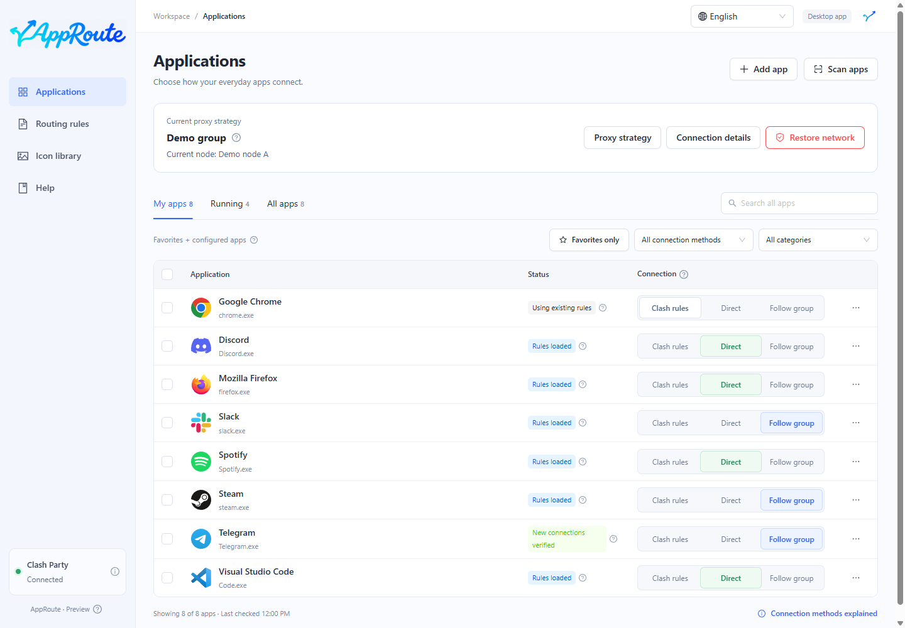

# Connect an app directly

This example uses QQ Music on Windows. Identified new connections that enter Clash should use DIRECT without a remote proxy node.

1. Confirm Clash Party is connected. Search for QQ Music or QQMusic.exe.
2. Choose Direct on that app's row and wait for the rule to be ready.
3. Play uncached content. If needed, normally quit and reopen QQ Music.
4. Open app details and check that an observed connection uses DIRECT.

Expected: the rule becomes ready first, then connection verification appears when matching traffic is observed. Recognized helper processes are included; unidentified shared components may not be covered.

If there is no verified connection, try a fresh network operation, inspect the process in details, and confirm its traffic enters Clash. Apps that ignore the system proxy may not be captured; a loaded rule alone does not prove coverage.

Direct does not disable another VPN or stop Clash Party. To remove this app's override, select Clash rules. To remove all AppRoute overrides, see [Maintenance](maintenance.md).
