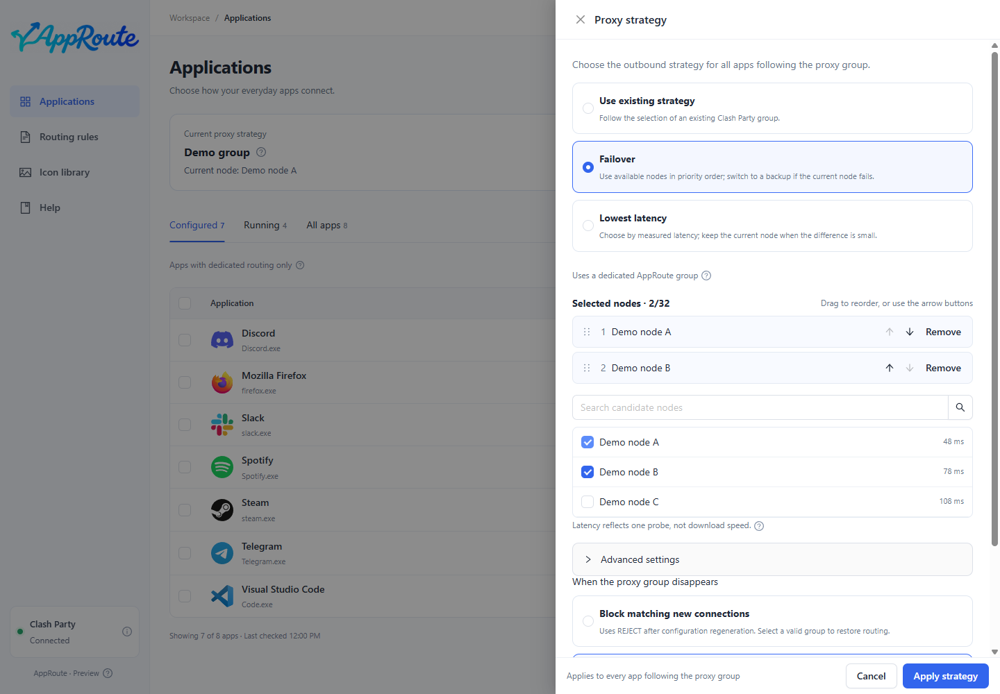

# Follow a proxy group

Goal: switch a node once in Clash Party and have new connections from configured apps follow it.

1. Open Proxy strategies and choose the existing-strategy option.
2. Select the group you actually change in Clash Party. Two groups can show the same node while keeping independent selections.
3. Save, then choose Follow proxy group for the target app.
4. Change that group's node in Clash Party, create a new connection in the target app and inspect its actual route.

Expected: the top summary shows the group's current selection; app details show observed connections. These are different evidence. Existing connections may still use the previous node.

A manual group does not automatically avoid a failed node. Use an existing automatic group or configure [fallback / latency-first selection](strategies.md).

If the group ultimately selects DIRECT, a connection can be direct. Following a group does not guarantee a remote proxy. A missing group follows the saved failure policy and requires checking the reported result. If unsure, remove the app override or [restore](maintenance.md).
