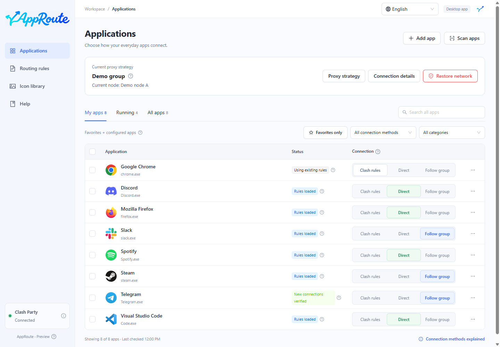

# AppRoute guide

Choose how each app connects while keeping your existing Clash Party rules.

AppRoute is a companion to Clash Party. It supplies no proxy nodes and does not replace the client. Install and start Clash Party first.

| Your task | Guide |
| --- | --- |
| Install for the first time | [Download](install.md) → [First steps](quickstart.md) |
| Connect a music app directly | [Direct connections](direct.md) |
| Follow node changes in Clash Party | [Follow a proxy group](follow-group.md) |
| Select backup or low-latency nodes | [Proxy strategies](strategies.md) |
| Upgrade, restore or uninstall | [Maintenance](maintenance.md) |
| Understand connection status | [FAQ](faq.md) |

Screenshots use isolated demo data, not your apps, nodes or connections. This is a preview; macOS is experimental. See [support boundaries](install.md#support).
