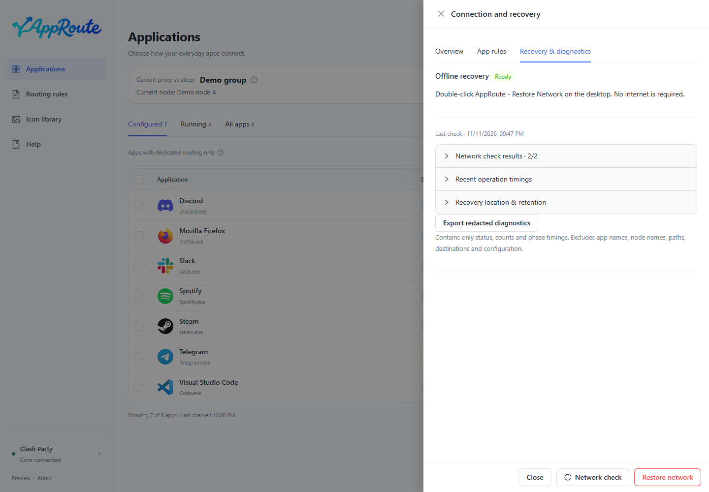

# Upgrade, recovery and removal

## Upgrade

1. Check your version in About and select the correct [download](install.md).
2. Fully quit AppRoute from the tray menu; closing the window only hides it.
3. Run the Windows installer, or replace AppRoute.app in Applications on Mac.
4. Reopen it, verify the version and app settings, then run a fresh network check.

There is no auto-update. Normal upgrades retain app preferences, routing records and recovery data. Do not delete user data to upgrade. On failure, preserve diagnostic information and report it. Downgrade data compatibility is not guaranteed.

## Restore network

Recovery disables only AppRoute-managed rules and dedicated strategies while preserving your original Clash Party configuration. It cannot promise to fix an ISP, another VPN or a broken node.

1. If the app opens, choose Restore network, review the scope and confirm.
2. Inspect the result and run a fresh network check.
3. If AppRoute or the internet is unavailable, use the independent recovery entry prepared before the first routing change; it needs neither ChatGPT nor internet access.
4. Connection details show the local recovery tool location. If the core is offline, runtime recovery needs reconnection and a subsequent check.

A network check is a timestamped observation. Recheck after connection changes or wake; an old 5/5 is not a guarantee of current connectivity.

The independent entry is named AppRoute - Restore Network (.cmd on Windows, .command on Mac). Its command-line messages are currently Chinese. Running it disables all AppRoute routing; it is not a read-only diagnostic.

## Transfer settings (source development version)

These additions are not included in the published 0.2.0-preview.2 installer. Use Settings and backups to export JSON, then preview an import and select apps. Existing routing is unchecked by default; unmatched paths cannot be imported.

Import details only merges app details and favorites. Import and apply requires confirmation and uses the existing rollback protection. Proxy apps follow the current group unless you explicitly restore the saved strategy; doing so also migrates existing proxy apps. Language restoration is optional. Each import creates a backup first. Files contain local paths and node names: keep them private.

## Uninstall

If you no longer want AppRoute routing, recover and verify first, then fully quit and uninstall. Exiting or uninstalling does not by itself remove persistent Clash rules. Windows uninstall keeps user data by default; removing the Mac app does not clear preferences. Safe one-click downgrade and cross-version data rollback are not provided.

## Report a problem

Copy version information from About. Include OS, architecture, client/core versions and reproduction steps. Review even sanitized diagnostic exports before posting. Never upload subscriptions, credentials, complete app inventories or personal paths.
