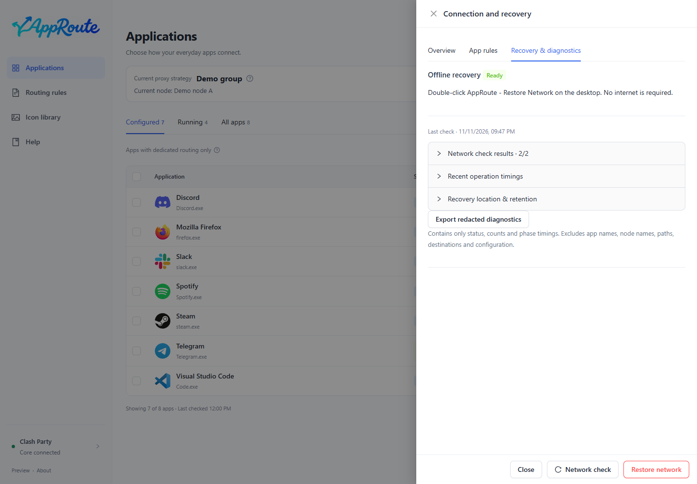

# Upgrade, recovery and removal

## Upgrade

1. Check your version in About and select the correct [download](install.md).
2. Fully quit AppRoute from the tray menu; closing the window only hides it.
3. Run the Windows installer, or replace AppRoute.app in Applications on Mac.
4. Reopen it, verify the version and app settings, then run a fresh network check.

The published 0.2.0-preview.2 installer has no auto-update. Normal upgrades retain app preferences, routing records and recovery data. Do not delete user data to upgrade. On failure, preserve diagnostic information and report it. Downgrade data compatibility is not guaranteed.

## In-app update checks (source development version)

Not included in 0.2.0-preview.2. New source builds show the version, GitHub and a More menu in the sidebar. Background checks are infrequent and can be disabled. Choose stable or preview releases, then back up and download within the app; the file is verified and downloads can be cancelled or retried. Installed Windows copies offer Install and restart, with another backup before quitting, installing and reopening. On Mac, open the DMG, quit and replace the app manually; folder builds require manual installation. Failed backups or verification prevent installation. The new version compares settings without overwriting differences. Checksums do not replace signing; verify network connections separately.

## Restore network

Recovery disables only AppRoute-managed rules and dedicated strategies while preserving your original Clash Party configuration. It cannot promise to fix an ISP, another VPN or a broken node.

1. If the app opens, choose Restore network, review the scope and confirm.
2. Inspect the result and run a fresh network check.
3. If AppRoute or the internet is unavailable, use the independent recovery entry prepared before the first routing change; it needs neither ChatGPT nor internet access.
4. Connection details show the local recovery tool location. If the core is offline, runtime recovery needs reconnection and a subsequent check.

A network check is a timestamped observation. Recheck after connection changes or wake; an old 5/5 is not a guarantee of current connectivity.

The independent entry is named AppRoute - Restore Network (.cmd on Windows, .command on Mac). Its command-line messages are currently Chinese. Running it disables all AppRoute routing; it is not a read-only diagnostic.

## Transfer settings (source development version)

These additions are not included in the published 0.2.0-preview.2 installer. Use Settings and backups to export JSON, then review differences and select apps. Existing routing is unchecked by default. For an unmatched item, bind it to the correct local app, review the rebuilt preview and select it again. Unbound items cannot be imported; names alone are never used to guess a match.

Import details only merges app details and favorites. Import and apply requires confirmation and uses the existing rollback protection. Proxy apps follow the current group unless you explicitly restore the saved strategy; doing so also migrates existing proxy apps. Language restoration is optional. Each import creates a backup first. Files contain local paths and node names: keep them private.

Local backups lets you create, preview, export or confirm deletion of one snapshot. Manual and pre-import backups contain full settings; routing history restores rules and strategy while preserving current favorites and categories. Damaged or unfinished records cannot be restored directly. Restoration still requires selecting apps. Deletion does not change current routing or the offline recovery tool.

## Scenarios, undo and program updates (source version)

- **Reuse several choices:** create a Routing scenario in Settings and backups, selecting apps and their modes. Saving or deleting a scenario does not change the network. Preview its differences, then select and confirm the apps to apply. Scenarios use the current proxy group; they do not store nodes, global strategy, language or temporary deadlines.
- **Undo a recent choice:** open Routing rules → Activity history to inspect time, source and differences. Only an eligible latest successful change can be previewed and undone. Later changes, strategy changes, temporary routing or domain exceptions prevent an unsafe overwrite. Use backup previews or app details for other recovery needs.
- **Handle a moved program:** choose Check program paths in Settings and backups. Only a missing old path can be rebound to a confirmed local program. Review both paths and select the app again. Applying replaces that app's old-path rules with rollback on failure; it never changes program files or shortcuts.

## Other Mihomo clients (source version)

Settings and backups → Other Mihomo clients → Check compatibility reads the chosen runtime configuration's local control endpoint, then checks process-detection settings and connection-list access. Cancel performs no check. Credentials are neither displayed nor stored. The file must describe an enabled, accessible local HTTP control endpoint; this check does not enable it for you.

A successful check does not enable routing integration: Clash Party still executes AppRoute's rules. Clash Verge Rev is the next priority, but its write and recovery adapter still needs implementation, followed by subscription-update and restart-persistence checks. Do not disable authentication or replace existing client configuration for this check.

## Uninstall

If you no longer want AppRoute routing, recover and verify first, then fully quit and uninstall. Exiting or uninstalling does not by itself remove persistent Clash rules. Windows uninstall keeps user data by default; removing the Mac app does not clear preferences. Safe one-click downgrade and cross-version data rollback are not provided.

## Report a problem

Copy version information from About. Include OS, architecture, client/core versions and reproduction steps. Review even sanitized diagnostic exports before posting. Never upload subscriptions, credentials, complete app inventories or personal paths.
