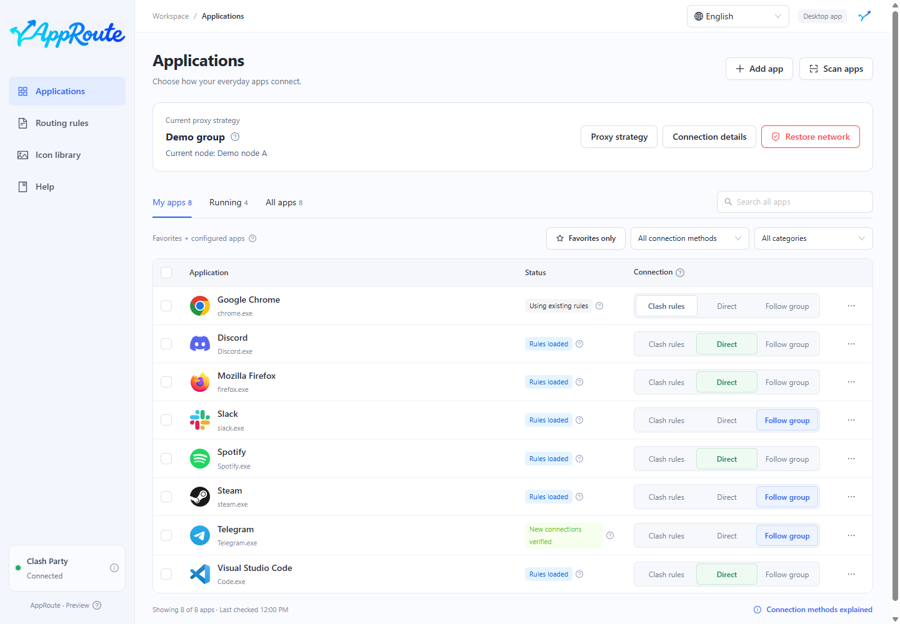
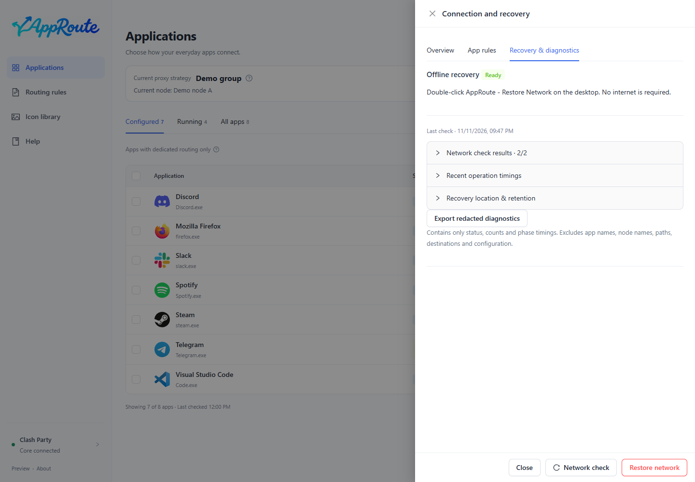

# First steps

Goal: configure one app and distinguish a loaded rule from a verified connection.

## Steps

1. Start Clash Party, confirm that it can connect, and keep Rule mode enabled.
2. Open AppRoute. The lower-left connection indicator should be connected. It reports control API access, not the health of every node.
3. Search for an app in All apps, or scan again. Search covers the full inventory.
4. Choose Direct or Follow proxy group. The default Clash rules option keeps the client's original routing.

Before using a proxy, choose the group in [Proxy strategies](strategies.md). Multiple selections can queue; a pending selection is not yet effective.

## Check the result

- A ready rule means the rule is loaded, with no matching new connection observed yet.
- A verified connection means a new connection matching the setting was observed.
- Open the status explanation or app details to inspect matched processes and the actual route.

Make the app perform a fresh network operation, such as playing uncached audio. Existing connections can retain their old route; AppRoute does not forcibly migrate them.

The first persistent override registration may require fully quitting and reopening Clash Party, then checking persistence again. Proxy access may briefly stop during that restart. Read the actual result rather than assuming a dismissed message means success.

If no connection is observed, see [FAQ](faq.md). For network problems, use [recovery](maintenance.md#recovery).

## Per-app checks and options (source development version)

These features are not included in the published 0.2.0-preview.2 installer.

Open App details and choose Check this app. This reads status without changing routing; expand each result for its explanation. Connection samples show the component, destination, matched rule, route chain and start time. The group's current choice is separate from the observed connection. No fresh connection means awaiting observation; check again after settings or connections change. Samples do not represent all traffic.

App details also offers two optional settings:

- **Temporary routing:** choose 15, 30 or 60 minutes. After confirmation, the app uses that mode until its previous choice is restored, or you end it early. An independent watcher continues after quitting the UI; reopen AppRoute after a computer restart. An offline core or failed check shows recovery pending, not success.
- **Domain exceptions:** first choose direct or proxy routing, then Edit exceptions. For example, keep the app direct but send `example.com` through the proxy. Up to 20 exact-domain or domain-suffix entries are supported; suffixes include subdomains. Entries apply only to this app's recognized program paths. Other destinations keep its base mode, and proxy entries follow the shared group. A missing group rejects the exception's connection instead of silently making it direct.

Temporary routing and domain exceptions cannot be enabled together. Returning to Clash rules removes this app's dedicated settings and exceptions. Cancel or Esc discards editing; existing connections are not forcibly switched. See [Maintenance](maintenance.md) for scenarios, activity history and changed program paths.
