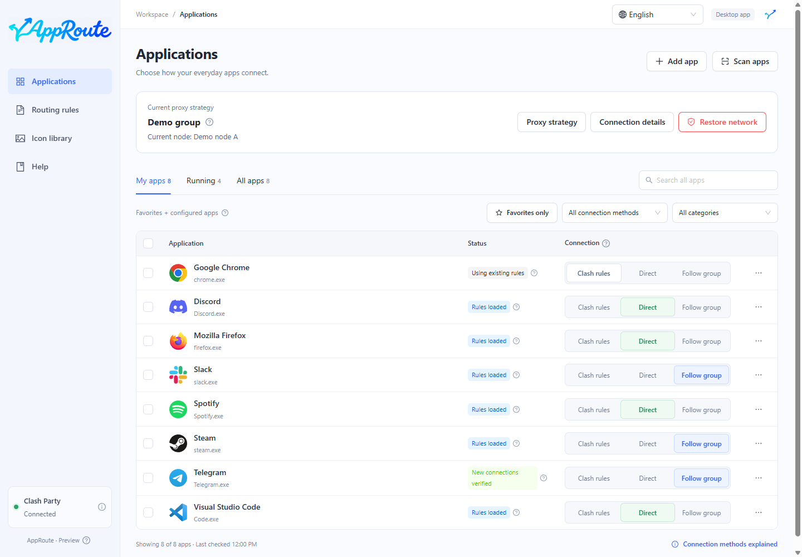
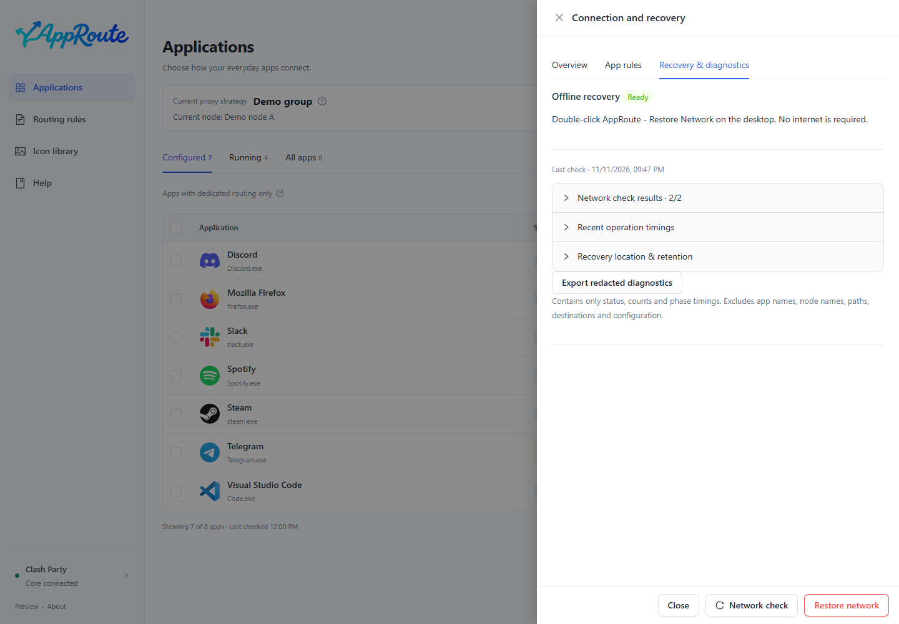

# First steps

Goal: configure one app and distinguish a loaded rule from a verified connection.

## Steps

1. Start Clash Party, confirm that it can connect, and keep Rule mode enabled.
2. Open AppRoute. The lower-left connection indicator should be connected. It reports control API access, not the health of every node.
3. Search for an app in All apps, or scan again. Search covers the full inventory.
4. Choose Direct or Follow proxy group. The default Clash rules option keeps the client's original routing.

Before using a proxy, choose the group in [Proxy strategies](strategies.md). Multiple selections can queue; a pending selection is not yet effective.

## Check the result

- A ready rule means the rule is loaded, with no matching new connection observed yet.
- A verified connection means a new connection matching the setting was observed.
- Open the status explanation or app details to inspect matched processes and the actual route.

Make the app perform a fresh network operation, such as playing uncached audio. Existing connections can retain their old route; AppRoute does not forcibly migrate them.

The first persistent override registration may require fully quitting and reopening Clash Party, then checking persistence again. Proxy access may briefly stop during that restart. Read the actual result rather than assuming a dismissed message means success.

If no connection is observed, see [FAQ](faq.md). For network problems, use [recovery](maintenance.md#recovery).
