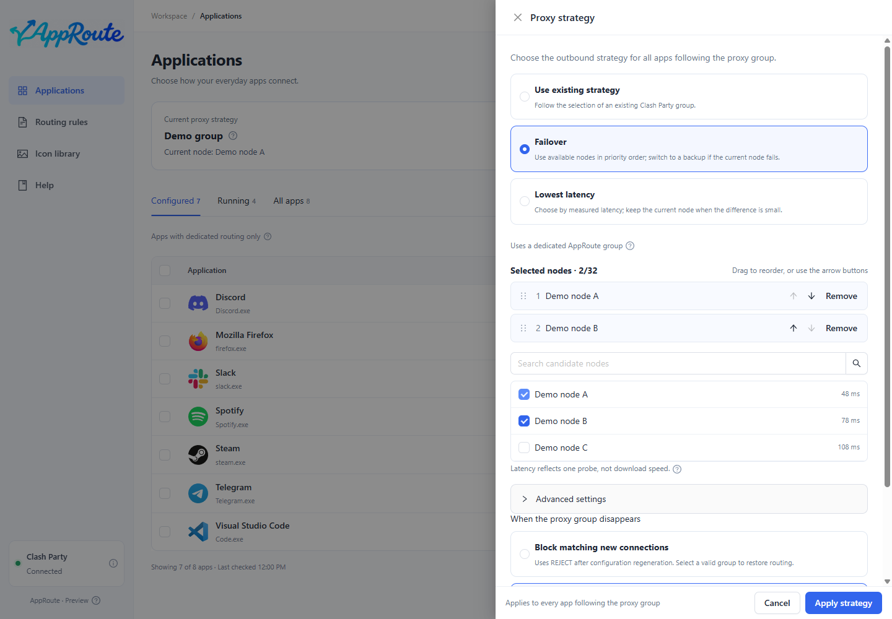

# Proxy strategies

Strategies decide how to select nodes. The app list decides which apps use the strategy. Mihomo executes the underlying behavior.

| Strategy | Use it when | Behavior |
| --- | --- | --- |
| Existing strategy | Clash Party already has the right group | Reuses that group's behavior |
| Fallback | You prefer an ordered list | Picks an available candidate by priority |
| Latency first | You want automatic low-latency selection | Uses probes and tolerance among candidates |

1. Open Proxy strategies at the top of application management.
2. Select an existing group, or select candidates for fallback / latency first.
3. For fallback, drag candidates into priority order. Review advanced probe settings and the missing-target policy when necessary.
4. Save and wait for success, then assign apps to Follow proxy group.

Expected: the summary shows the saved strategy and current selection; details show observed routes. Latency is not download speed, and a successful probe does not guarantee access to every destination.

AppRoute uses its own dedicated groups. If all automatic-strategy candidates fail, it does not silently switch to direct. Changing a strategy does not forcibly migrate old connections. On save failure, inspect rollback status and use [recovery](maintenance.md) if needed.
