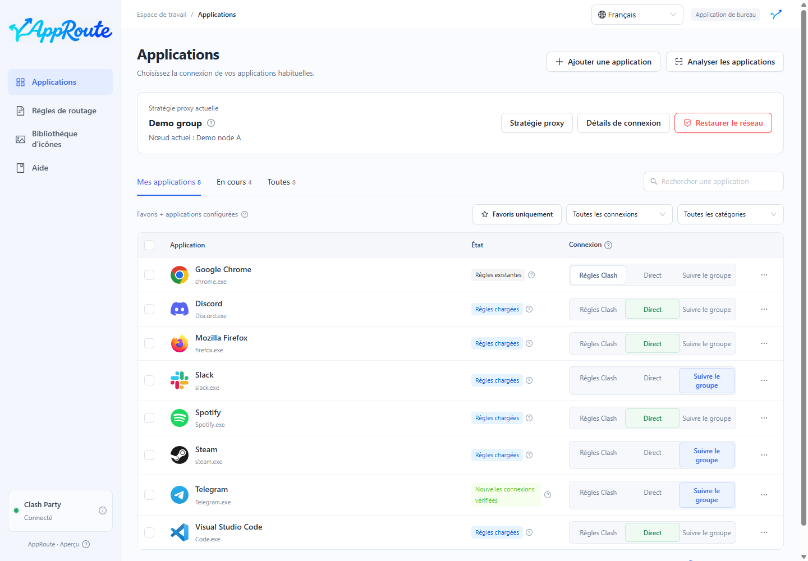

# Connecter une application directement

Exemple : QQ Music sous Windows. Les nouvelles connexions identifiées qui entrent dans Clash doivent utiliser DIRECT, sans nœud proxy distant.

1. Vérifiez que Clash Party est connecté et recherchez QQ Music ou QQMusic.exe.
2. Choisissez le mode direct sur cette ligne et attendez que la règle soit prête.
3. Lisez un contenu non mis en cache ; si nécessaire, quittez normalement QQ Music puis rouvrez-le.
4. Vérifiez dans les détails qu’une connexion observée utilise DIRECT.

La règle devient prête avant l’apparition du résultat de vérification. Les processus auxiliaires reconnus sont inclus ; les composants partagés non identifiés ne sont pas garantis.

Sans validation, déclenchez une nouvelle requête, inspectez le processus et vérifiez que le trafic entre dans Clash. Une application ignorant le proxy système peut échapper à la prise en charge ; une règle chargée ne prouve pas la couverture du trafic.

Le mode direct n’arrête ni un autre VPN ni Clash Party. Pour retirer le réglage d’une application, revenez aux règles Clash. Pour tout retirer, consultez la [maintenance](maintenance.md).
