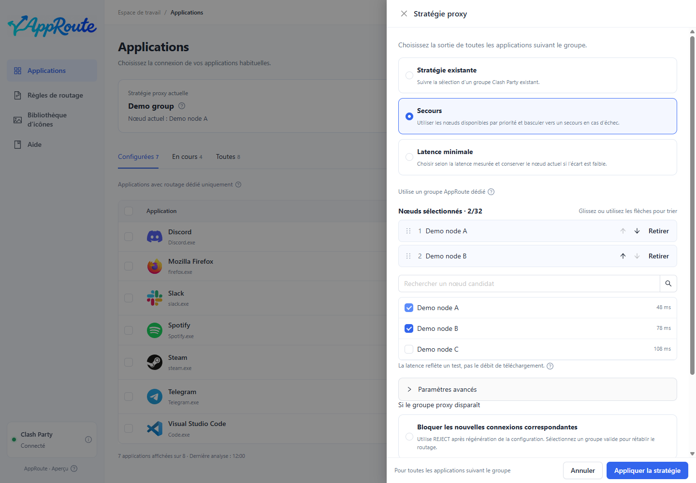

# Suivre un groupe proxy

Objectif : changer une fois le nœud dans Clash Party et faire suivre les nouvelles connexions des applications configurées.

1. Ouvrez les stratégies proxy et choisissez l’utilisation d’une stratégie existante.
2. Sélectionnez le groupe que vous modifiez réellement dans Clash Party. Deux groupes affichant le même nœud peuvent conserver des choix indépendants.
3. Enregistrez puis activez le suivi du groupe pour l’application.
4. Changez le nœud de ce groupe, créez une nouvelle connexion dans l’application et inspectez sa route effective.

Le résumé indique la sélection actuelle du groupe ; les détails indiquent les connexions observées. Ce sont deux informations distinctes. Les connexions existantes peuvent garder l’ancien nœud.

Un groupe manuel n’évite pas automatiquement un nœud défaillant. Utilisez un groupe automatique existant ou configurez le [secours / la priorité à la latence](strategies.md).

Si la sélection finale est DIRECT, la connexion peut être directe. Un groupe disparu déclenche la politique enregistrée : vérifiez le résultat affiché. En cas de doute, retirez le réglage de l’application ou [restaurez](maintenance.md).
