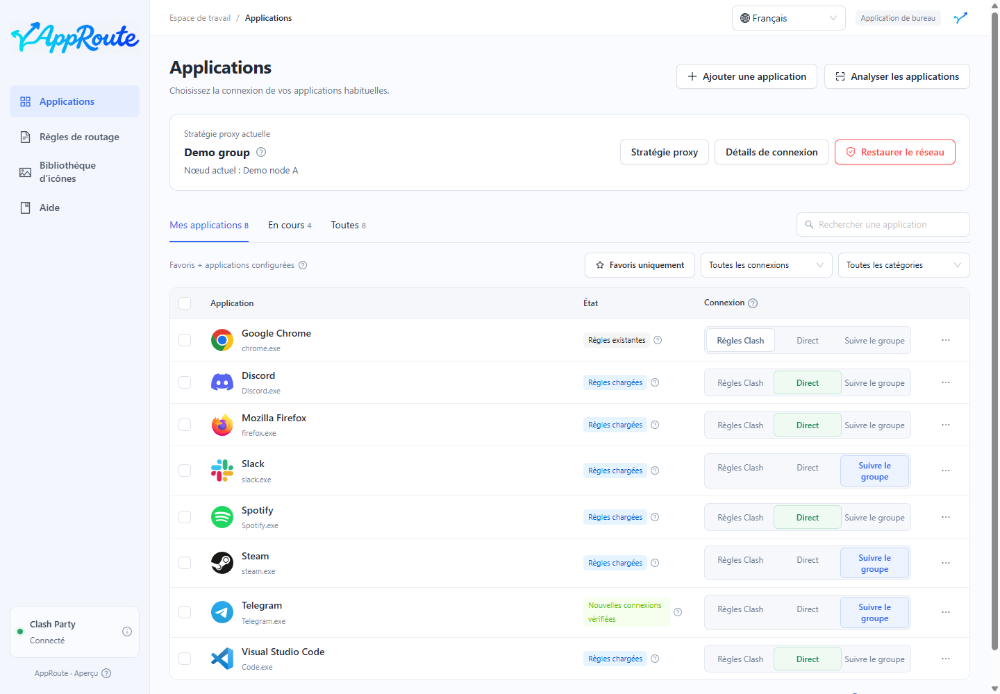

# Guide AppRoute

Choisissez le mode de connexion de chaque application en conservant les règles existantes de Clash Party.

AppRoute accompagne Clash Party, sans fournir de nœuds proxy ni remplacer ce client. Installez et démarrez Clash Party avant de commencer.

| Votre objectif | Guide |
| --- | --- |
| Première installation | [Télécharger](install.md) → [Premiers pas](quickstart.md) |
| Connecter une application directement | [Connexion directe](direct.md) |
| Suivre les changements de nœud | [Suivre un groupe](follow-group.md) |
| Choisir des nœuds de secours ou à faible latence | [Stratégies proxy](strategies.md) |
| Mettre à jour, restaurer ou désinstaller | [Maintenance](maintenance.md) |
| Comprendre les états affichés | [FAQ](faq.md) |

Les captures utilisent des données de démonstration isolées. Elles ne représentent pas vos connexions. Il s’agit d’une préversion ; macOS est expérimental. Consultez le [périmètre pris en charge](install.md#support).
