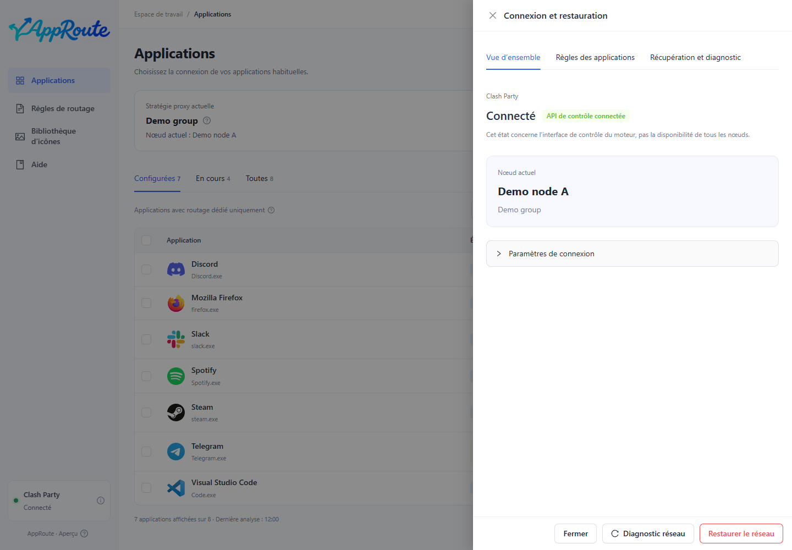

# Mise à jour, restauration et désinstallation

## Mise à jour

1. Vérifiez la version dans À propos et choisissez le bon [téléchargement](install.md).
2. Quittez complètement AppRoute depuis son icône de notification ; fermer la fenêtre ne suffit pas.
3. Exécutez l’installateur Windows ou remplacez AppRoute.app dans Applications sur Mac.
4. Rouvrez, vérifiez la version et les réglages, puis refaites un diagnostic réseau.

Il n’y a pas de mise à jour automatique. Les mises à jour normales conservent préférences, règles enregistrées et données de restauration. Ne supprimez pas les données utilisateur. En cas d’échec, conservez le diagnostic et signalez-le. La compatibilité des données lors d’un retour à une ancienne version n’est pas garantie.

## Vérifier les mises à jour dans l’application (version source)

Cette fonction ne figure pas dans l’installateur 0.2.0-preview.2. Dans les nouvelles versions source, ouvrez À propos → Mises à jour, choisissez les versions stables ou les préversions, puis consultez les notes, le programme adapté et son SHA-256. Sauvegarder et télécharger enregistre les paramètres avant d’ouvrir le téléchargement du projet ; vous lancez toujours l’installation manuellement. La nouvelle version compare les paramètres sans écraser les différences. Une empreinte ne remplace pas la signature de l’éditeur ; les connexions réelles restent à vérifier séparément.

## Restaurer le réseau

La restauration désactive uniquement les règles et stratégies gérées par AppRoute et conserve la configuration originale de Clash Party. Elle ne garantit pas la réparation d’un accès opérateur, d’un autre VPN ou d’un nœud défaillant.

1. Si l’application s’ouvre, choisissez la restauration, vérifiez sa portée et confirmez.
2. Consultez le résultat puis relancez le diagnostic.
3. Sans AppRoute ou sans internet, utilisez l’entrée indépendante préparée avant le premier changement de routage. Ni ChatGPT ni internet ne sont nécessaires.
4. Les détails de connexion indiquent l’emplacement de l’outil local. Si le moteur est arrêté, sa remise en connexion est nécessaire pour vérifier la restauration à l’exécution.

Un diagnostic décrit un instant donné. Après un changement ou un réveil, recommencez : un ancien 5/5 ne garantit pas la connexion actuelle.

L’entrée indépendante s’appelle AppRoute - Restore Network (.cmd sous Windows, .command sur Mac). Ses messages en ligne de commande restent en chinois. Son exécution désactive tout le routage AppRoute ; ce n’est pas un diagnostic en lecture seule.

## Transférer les paramètres (version de développement source)

Ces ajouts ne figurent pas dans l’installateur publié 0.2.0-preview.2. Exportez un JSON dans Paramètres et sauvegardes, puis examinez les différences et sélectionnez les applications. Les routages existants sont décochés par défaut. Une entrée sans correspondance peut être associée à la bonne application locale : vérifiez le nouvel aperçu et sélectionnez-la de nouveau. Aucune importation n’est possible avant l’association ; le nom seul ne sert jamais à deviner la cible.

L’import des informations seules fusionne les informations et les favoris. L’import avec application demande une confirmation et utilise la protection de restauration existante. Le groupe proxy actuel reste utilisé sauf restauration explicite de la stratégie enregistrée, qui migre aussi les applications proxy existantes. La langue est facultative. Une sauvegarde précède chaque import. Le fichier contient des chemins locaux et des noms de nœuds : gardez-le privé.

Sauvegardes locales permet de créer, prévisualiser, exporter ou confirmer la suppression d’un instantané. Les sauvegardes manuelles et préalables contiennent tous les paramètres ; l’historique restaure uniquement les règles et la stratégie, en conservant favoris et catégories actuels. Les enregistrements endommagés ou inachevés ne sont pas directement restaurables. Sélectionnez toujours les applications à restaurer. La suppression ne change ni le routage actuel ni l’outil de restauration hors ligne.

## Scénarios, annulation et programmes déplacés (version source)

- **Réutiliser plusieurs choix** : créez un scénario dans Paramètres et sauvegardes, avec les applications et leurs modes. Enregistrer ou supprimer un scénario ne change pas le réseau. Prévisualisez les différences, puis sélectionnez et confirmez les applications. Le groupe proxy actuel est utilisé ; les nœuds, la stratégie globale, la langue et les échéances temporaires ne sont pas enregistrés.
- **Annuler un choix récent** : ouvrez Règles de routage → Historique des opérations pour consulter la date, l’origine et les différences. Seule la dernière opération réussie admissible peut être prévisualisée puis annulée. Les changements ultérieurs, changements de stratégie, réglages temporaires ou exceptions empêchent un écrasement forcé. Pour les autres restaurations, utilisez les sauvegardes ou les détails de l’application.
- **Traiter un programme déplacé** : vérifiez les chemins dans Paramètres et sauvegardes. Seul un ancien chemin devenu indisponible peut être réassocié à un programme local confirmé. Comparez les deux chemins et sélectionnez de nouveau l’application. L’application remplace ses anciennes règles avec restauration en cas d’échec ; les fichiers du programme et les raccourcis restent intacts.

## Autres clients Mihomo (version source)

Paramètres et sauvegardes → Autres clients Mihomo → Vérifier la compatibilité lit le point de contrôle local du fichier d’exécution choisi, puis vérifie la détection des processus et l’accès aux connexions. Annuler ne déclenche aucun contrôle. Les identifiants ne sont ni affichés ni enregistrés. Le fichier doit décrire une API HTTP locale active et accessible ; le contrôle ne l’active pas automatiquement.

Un résultat positif n’active pas l’intégration du routage : Clash Party continue d’exécuter les règles AppRoute. Clash Verge Rev est la prochaine priorité, mais son adaptateur d’écriture et de restauration reste à implémenter, puis à vérifier lors des mises à jour d’abonnement et des redémarrages. Ne désactivez pas l’authentification et ne remplacez pas votre configuration pour ce contrôle.

## Désinstallation

Si vous ne voulez plus du routage AppRoute, restaurez et vérifiez avant de quitter puis de désinstaller. Quitter ou désinstaller ne retire pas à lui seul les règles Clash persistantes. Windows conserve les données par défaut ; supprimer l’application Mac ne supprime pas les préférences. Le retour sécurisé en un clic à une ancienne version et la restauration de données entre versions ne sont pas fournis.

## Signaler un problème

Copiez les informations de version depuis À propos. Joignez OS, architecture, versions du client et du moteur, étapes de reproduction. Vérifiez même les diagnostics expurgés avant envoi. N’envoyez ni abonnements, ni identifiants, ni inventaire complet, ni chemins personnels.
