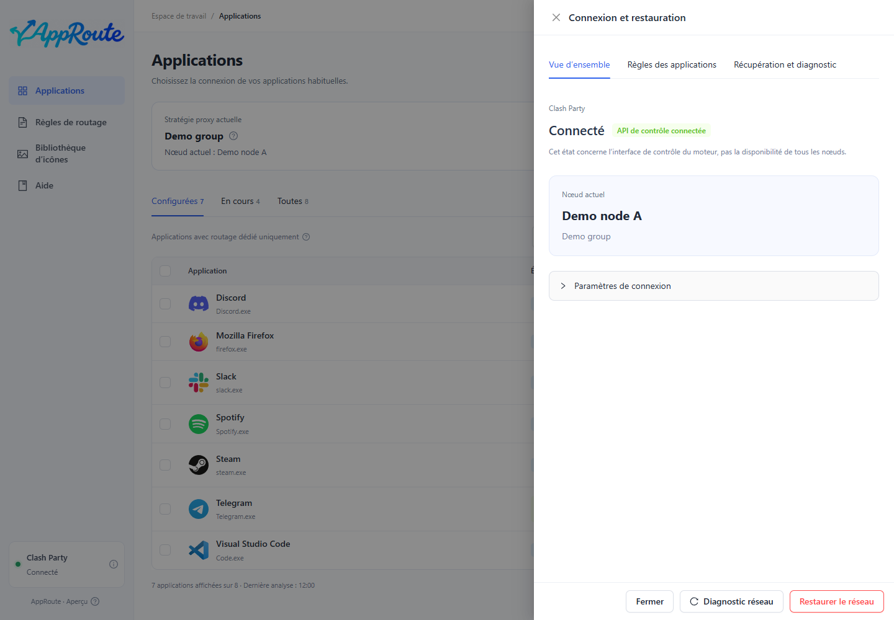

# Mise à jour, restauration et désinstallation

## Mise à jour

1. Vérifiez la version dans À propos et choisissez le bon [téléchargement](install.md).
2. Quittez complètement AppRoute depuis son icône de notification ; fermer la fenêtre ne suffit pas.
3. Exécutez l’installateur Windows ou remplacez AppRoute.app dans Applications sur Mac.
4. Rouvrez, vérifiez la version et les réglages, puis refaites un diagnostic réseau.

Il n’y a pas de mise à jour automatique. Les mises à jour normales conservent préférences, règles enregistrées et données de restauration. Ne supprimez pas les données utilisateur. En cas d’échec, conservez le diagnostic et signalez-le. La compatibilité des données lors d’un retour à une ancienne version n’est pas garantie.

## Restaurer le réseau

La restauration désactive uniquement les règles et stratégies gérées par AppRoute et conserve la configuration originale de Clash Party. Elle ne garantit pas la réparation d’un accès opérateur, d’un autre VPN ou d’un nœud défaillant.

1. Si l’application s’ouvre, choisissez la restauration, vérifiez sa portée et confirmez.
2. Consultez le résultat puis relancez le diagnostic.
3. Sans AppRoute ou sans internet, utilisez l’entrée indépendante préparée avant le premier changement de routage. Ni ChatGPT ni internet ne sont nécessaires.
4. Les détails de connexion indiquent l’emplacement de l’outil local. Si le moteur est arrêté, sa remise en connexion est nécessaire pour vérifier la restauration à l’exécution.

Un diagnostic décrit un instant donné. Après un changement ou un réveil, recommencez : un ancien 5/5 ne garantit pas la connexion actuelle.

L’entrée indépendante s’appelle AppRoute - Restore Network (.cmd sous Windows, .command sur Mac). Ses messages en ligne de commande restent en chinois. Son exécution désactive tout le routage AppRoute ; ce n’est pas un diagnostic en lecture seule.

## Désinstallation

Si vous ne voulez plus du routage AppRoute, restaurez et vérifiez avant de quitter puis de désinstaller. Quitter ou désinstaller ne retire pas à lui seul les règles Clash persistantes. Windows conserve les données par défaut ; supprimer l’application Mac ne supprime pas les préférences. Le retour sécurisé en un clic à une ancienne version et la restauration de données entre versions ne sont pas fournis.

## Signaler un problème

Copiez les informations de version depuis À propos. Joignez OS, architecture, versions du client et du moteur, étapes de reproduction. Vérifiez même les diagnostics expurgés avant envoi. N’envoyez ni abonnements, ni identifiants, ni inventaire complet, ni chemins personnels.
