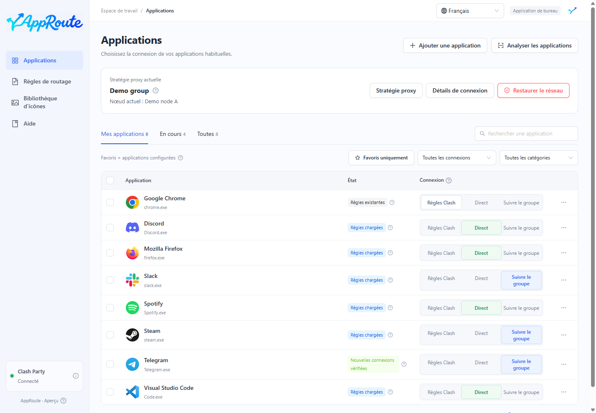
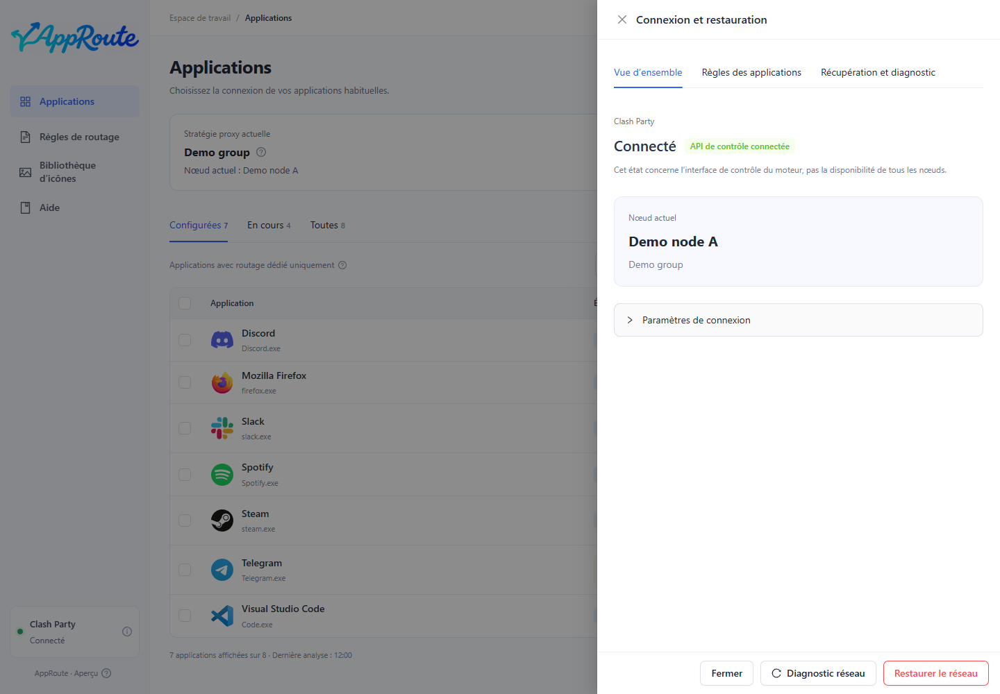

# Premiers pas

Objectif : configurer une application et distinguer une règle chargée d’une connexion vérifiée.

1. Démarrez Clash Party, vérifiez sa propre connexion et gardez le mode Règles.
2. Ouvrez AppRoute et vérifiez l’indicateur en bas à gauche. Il concerne l’API de contrôle, pas la disponibilité de tous les nœuds.
3. Recherchez l’application dans la liste complète ou relancez l’analyse. La recherche couvre tout l’inventaire.
4. Choisissez la connexion directe ou le suivi du groupe. Le choix par défaut conserve les règles Clash existantes.

Avant d’utiliser un proxy, choisissez le groupe dans les [stratégies](strategies.md). Plusieurs changements peuvent attendre dans une file : une sélection en attente n’est pas encore appliquée.

## Vérifier le résultat

Une règle prête est chargée, mais aucune nouvelle connexion correspondante n’a encore été observée. Une connexion vérifiée signifie qu’un trafic conforme au réglage a été observé. Ouvrez l’explication de l’état ou les détails de l’application pour inspecter les processus et la route.

Déclenchez une nouvelle opération réseau, par exemple un morceau non mis en cache. Les connexions déjà ouvertes peuvent conserver leur ancienne route ; AppRoute ne les migre pas de force.

Le premier enregistrement de la surcharge persistante peut nécessiter de quitter complètement puis de rouvrir Clash Party et de vérifier la persistance. La connexion proxy peut être brièvement interrompue. Lisez le résultat réel du contrôle.

Sans connexion observée, consultez la [FAQ](faq.md). En cas de problème réseau, utilisez la [restauration](maintenance.md#recovery).

## Vérification et options par application (version source)

Ces fonctions ne figurent pas dans l’installateur publié 0.2.0-preview.2.

Ouvrez Détails de l’application puis Vérifier cette application. Ce contrôle lit l’état sans modifier le routage ; développez chaque résultat pour en connaître la raison. Les échantillons montrent le composant, la destination, la règle appliquée, la chaîne de sortie et l’heure de début. Le choix actuel du groupe est distinct de la connexion observée. Sans nouvelle connexion, le résultat reste en attente d’observation. Recommencez après un changement de réglage ou de connexion ; les échantillons ne représentent pas tout le trafic.

Deux réglages facultatifs sont également proposés :

- **Routage temporaire** : choisissez 15, 30 ou 60 minutes et confirmez. Le choix précédent est rétabli à l’échéance, ou plus tôt si vous terminez l’opération. Un processus indépendant continue après la fermeture de l’interface ; rouvrez AppRoute après un redémarrage de l’ordinateur. Si le moteur est hors ligne ou si le contrôle échoue, la restauration reste en attente.
- **Exceptions par domaine** : choisissez d’abord le mode direct ou proxy de l’application, puis Modifier les exceptions. Par exemple, gardez le mode direct en envoyant seulement `example.com` au proxy. Jusqu’à 20 domaines exacts ou suffixes incluant les sous-domaines sont acceptés. Chaque entrée concerne uniquement les chemins reconnus de cette application. Les autres destinations conservent son mode de base ; les exceptions proxy suivent le groupe commun. Si ce groupe disparaît, leur connexion est refusée au lieu de passer silencieusement en direct.

Le routage temporaire et les exceptions ne peuvent pas être actifs ensemble. Revenir aux règles Clash supprime les réglages dédiés et les exceptions de cette application. Annuler ou Échap n’applique pas les modifications ; les connexions existantes ne sont pas forcées à changer. Consultez la [maintenance](maintenance.md) pour les scénarios, l’historique et les changements de chemin.
