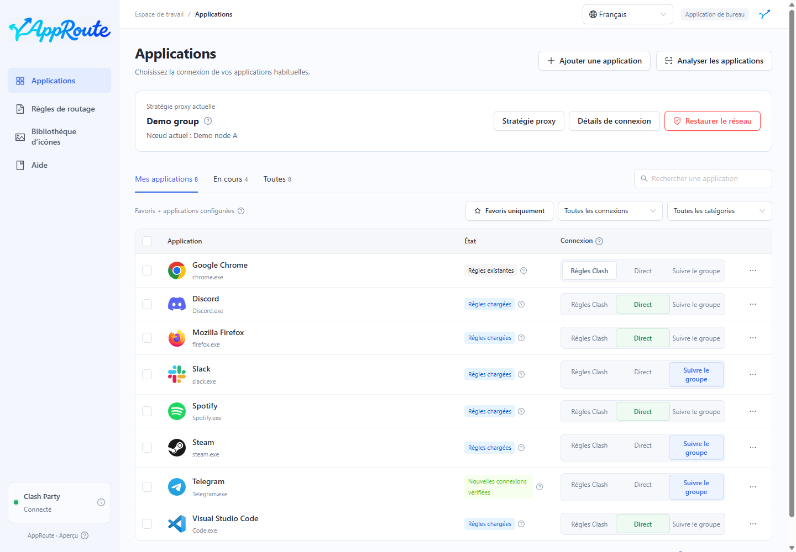
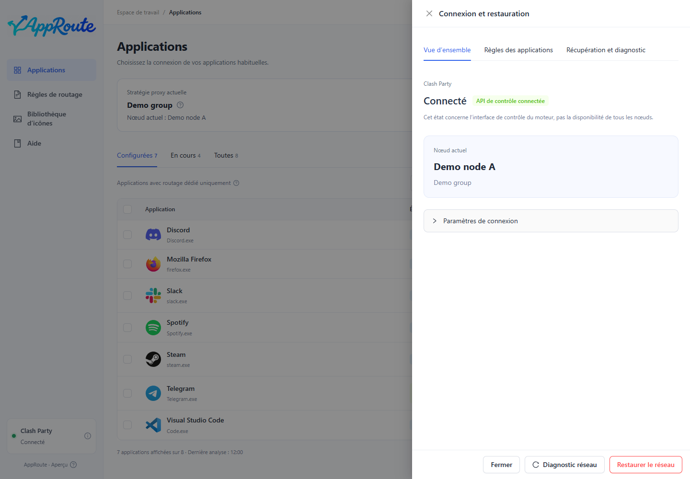

# Premiers pas

Objectif : configurer une application et distinguer une règle chargée d’une connexion vérifiée.

1. Démarrez Clash Party, vérifiez sa propre connexion et gardez le mode Règles.
2. Ouvrez AppRoute et vérifiez l’indicateur en bas à gauche. Il concerne l’API de contrôle, pas la disponibilité de tous les nœuds.
3. Recherchez l’application dans la liste complète ou relancez l’analyse. La recherche couvre tout l’inventaire.
4. Choisissez la connexion directe ou le suivi du groupe. Le choix par défaut conserve les règles Clash existantes.

Avant d’utiliser un proxy, choisissez le groupe dans les [stratégies](strategies.md). Plusieurs changements peuvent attendre dans une file : une sélection en attente n’est pas encore appliquée.

## Vérifier le résultat

Une règle prête est chargée, mais aucune nouvelle connexion correspondante n’a encore été observée. Une connexion vérifiée signifie qu’un trafic conforme au réglage a été observé. Ouvrez l’explication de l’état ou les détails de l’application pour inspecter les processus et la route.

Déclenchez une nouvelle opération réseau, par exemple un morceau non mis en cache. Les connexions déjà ouvertes peuvent conserver leur ancienne route ; AppRoute ne les migre pas de force.

Le premier enregistrement de la surcharge persistante peut nécessiter de quitter complètement puis de rouvrir Clash Party et de vérifier la persistance. La connexion proxy peut être brièvement interrompue. Lisez le résultat réel du contrôle.

Sans connexion observée, consultez la [FAQ](faq.md). En cas de problème réseau, utilisez la [restauration](maintenance.md#recovery).
