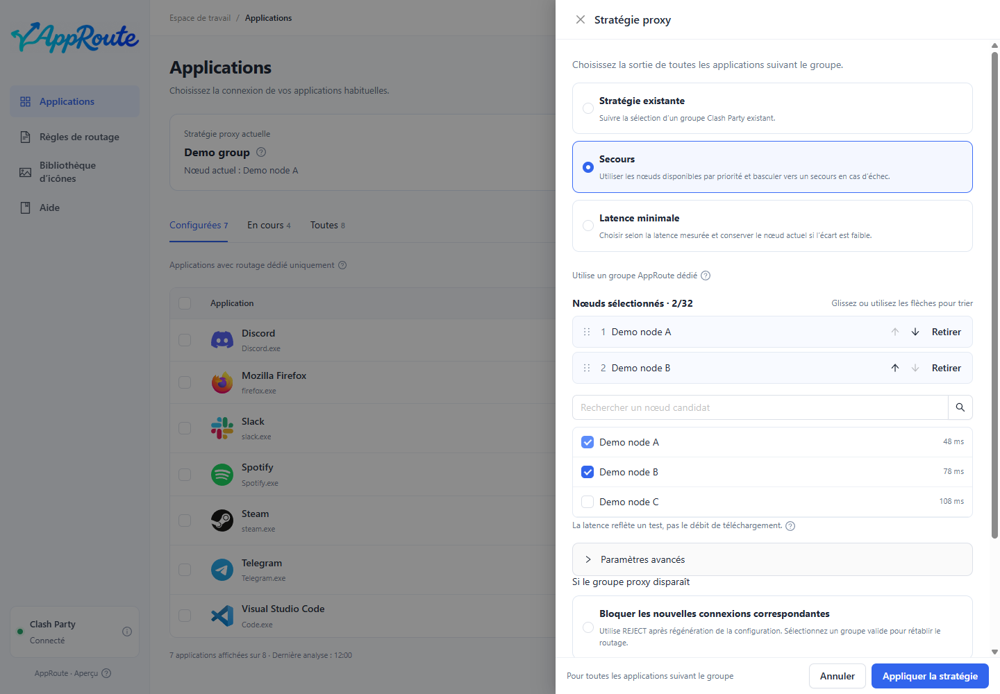

# Stratégies proxy

La stratégie choisit les nœuds ; la liste d’applications choisit qui l’utilise. Mihomo exécute le comportement réseau.

| Stratégie | Usage | Fonctionnement |
| --- | --- | --- |
| Stratégie existante | Réutiliser un groupe configuré | Conserve son comportement |
| Secours | Préférer un ordre précis | Choisit un candidat disponible par priorité |
| Priorité à la latence | Automatiser le choix | Utilise les sondes et la tolérance |

1. Ouvrez les stratégies en haut de la gestion des applications.
2. Choisissez un groupe existant ou les candidats pour la stratégie automatique.
3. Pour le secours, faites glisser les candidats dans l’ordre souhaité. Au besoin, vérifiez les paramètres avancés de sondage et le traitement d’une cible disparue.
4. Enregistrez, attendez le succès, puis configurez les applications pour suivre le groupe.

Le résumé montre la stratégie enregistrée et la sélection actuelle. Les détails montrent les routes observées. Une faible latence n’est pas une mesure du débit ; une sonde réussie ne garantit pas l’accès à tous les sites.

AppRoute utilise ses propres groupes. Si tous les candidats automatiques échouent, il ne passe pas silencieusement en direct. Les anciennes connexions ne sont pas migrées de force. Si l’enregistrement échoue, vérifiez le retour arrière et utilisez la [restauration](maintenance.md) si nécessaire.
