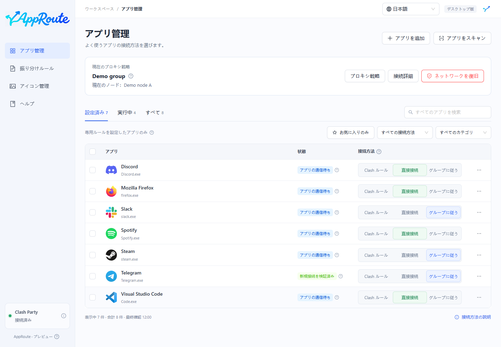

# アプリを直接接続する

Windows の QQ 音楽を例にします。識別され、Clash に入った新規接続を DIRECT に送り、リモートノードを経由させない設定です。

1. Clash Party の接続を確認し、QQ 音楽または QQMusic.exe を検索します。
2. 対象行で直接接続を選び、ルールの準備を待ちます。
3. 未キャッシュの曲を再生します。必要なら QQ 音楽を通常の手順で終了・再起動します。
4. アプリ詳細で、観測された接続が DIRECT を使っているか確認します。

先にルール準備の状態が表示され、一致する通信を観測すると検証結果が表示されます。認識できた補助プロセスも対象ですが、未識別の共有コンポーネントは保証しません。

緑の検証表示にならない場合は、新規通信を発生させ、詳細のプロセスを確認してください。システムプロキシを使わないアプリは Clash に入らない場合があり、ルールがあるだけでは通信の捕捉を証明できません。

直接接続は別の VPN や Clash Party を停止しません。1 アプリの設定を解除するには Clash ルールに戻します。全体の解除は[復旧](maintenance.md)を使います。
