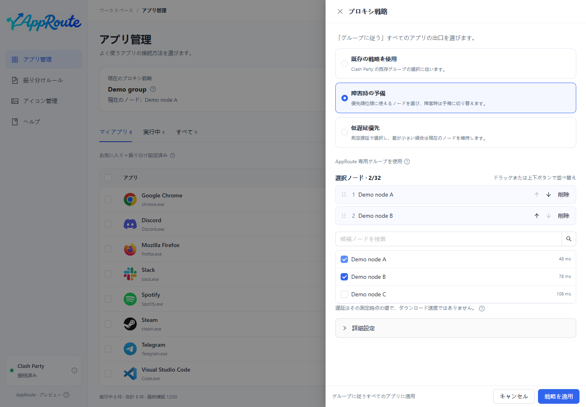

# プロキシグループに追従する

Clash Party でノードを 1 回変更すると、設定したアプリの新規接続が追従します。

1. プロキシ戦略を開き、既存戦略を使う選択肢を選びます。
2. Clash Party で普段切り替えているグループを指定します。同じノードを表示していても別グループの選択は独立しています。
3. 保存後、対象アプリをグループ追従に設定します。
4. Clash Party 側でノードを変更し、対象アプリで新しい通信を行い、詳細の実際の経路を確認します。

上部はグループの現在の選択、アプリ詳細は観測した接続です。両者は別の情報であり、既存接続は元のノードを使い続ける場合があります。

手動グループは故障ノードを自動回避しません。既存の自動グループか、[フェイルオーバー・遅延優先](strategies.md)を使ってください。

最終的に DIRECT を選ぶグループなら直接接続になる場合があります。グループが消失した場合は保存した異常時の方針に従い、表示結果を確認します。不明な場合はアプリ設定を解除するか[復旧](maintenance.md)してください。
