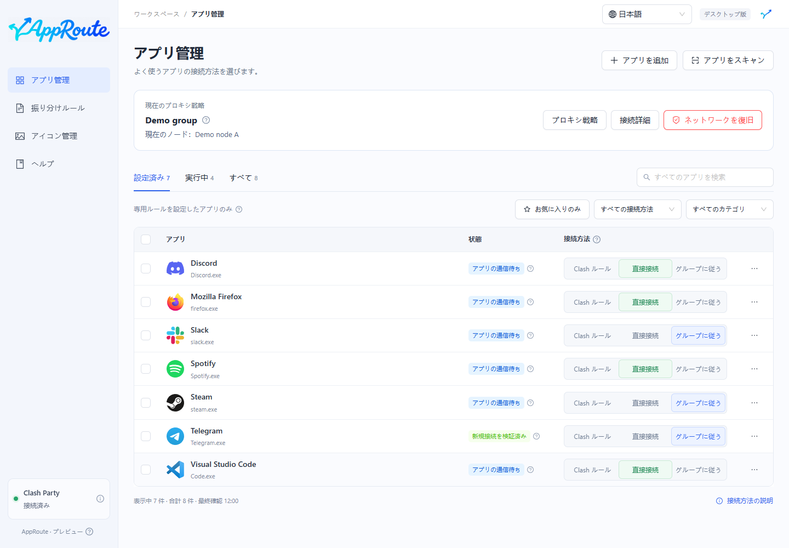

# AppRoute ガイド

アプリごとに接続方法を選び、Clash Party の既存ルールを保持します。

AppRoute は Clash Party の補助アプリです。プロキシノードは提供せず、Clash Party の代わりにはなりません。先に Clash Party をインストールして起動してください。

| 目的 | ガイド |
| --- | --- |
| 初めてインストールする | [ダウンロード](install.md) → [使い始める](quickstart.md) |
| 音楽アプリなどを直接接続する | [直接接続](direct.md) |
| Clash Party のノード変更に追従する | [プロキシグループに追従](follow-group.md) |
| 予備ノードや低遅延ノードを選ぶ | [プロキシ戦略](strategies.md) |
| 更新・復旧・削除する | [保守と復旧](maintenance.md) |
| 状態の意味を確認する | [よくある質問](faq.md) |

画像は隔離したデモデータです。実際のアプリや接続状態とは異なります。現在はプレビュー版、Mac は実験版です。[対応範囲](install.md#support)をご確認ください。
