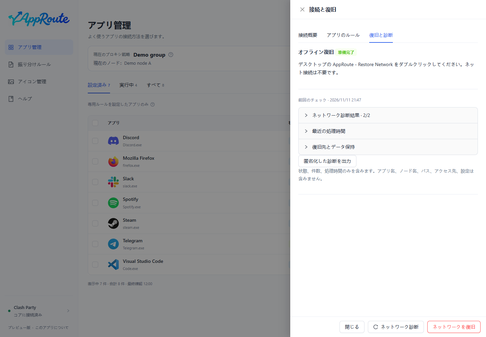

# 更新・復旧・アンインストール

## 更新

1. 「このアプリについて」で版を確認し、[対応パッケージ](install.md)を取得します。
2. トレイメニューから完全に終了します。ウィンドウを閉じるだけでは終了しません。
3. Windows は新しいインストーラーを実行し、Mac はアプリケーション内の AppRoute.app を置き換えます。
4. 再起動後に版、アプリ設定、接続を確認し、ネットワーク診断を再実行します。

自動更新はありません。通常の更新では設定と復旧データを保持します。更新のためにユーザーデータを削除しないでください。失敗した場合は診断情報を保存して報告します。ダウングレード時のデータ互換性は保証しません。

## アプリ内の更新確認（ソース開発版）

0.2.0-preview.2 インストーラーには含まれません。新しいソース版では「このアプリについて → アプリの更新」で安定版またはプレビュー版を選び、説明・対応パッケージ・SHA-256 を確認できます。「バックアップしてダウンロード」は設定を保存してからプロジェクトのダウンロードを開きます。インストーラーは手動で実行します。新版は既存設定を読み取り専用で照合し、差分を自動で上書きしません。ハッシュは発行者署名の代わりにはならず、実際の通信は別途確認が必要です。

## ネットワークを復旧する

復旧は AppRoute が管理するルールと専用戦略だけを無効にし、元の Clash Party 設定を保持します。回線、別 VPN、故障ノードの修復は保証できません。

1. アプリが開く場合はネットワーク復旧を選び、対象範囲を確認して実行します。
2. 結果を確認し、診断をやり直します。
3. アプリやインターネットが使えない場合は、最初の分流適用前に用意した独立した復旧入口を使います。ChatGPT やインターネットは不要です。
4. 接続詳細にローカル復旧ツールの場所が表示されます。コア停止中は再接続後に実行状態を再確認する必要があります。

診断は特定時点の記録です。状態変更やスリープ復帰後は再実行し、古い 5/5 を現在の保証と解釈しないでください。

独立入口は AppRoute - Restore Network です（Windows は .cmd、Mac は .command）。コマンドライン表示は現在中国語です。実行すると AppRoute の分流をすべて無効にするため、読み取り専用の診断として実行しないでください。

## 設定の移行（ソース開発版）

この追加機能は公開済みの 0.2.0-preview.2 インストーラーには含まれません。「設定とバックアップ」で JSON を書き出し、読み込み時に差分を確認してアプリを選びます。既存の振り分けは初期状態で選択されません。一致しない項目は正しいローカルアプリに関連付け、新しいプレビューを確認して再選択できます。関連付け前は読み込めず、名前だけで一致を推測しません。

「情報のみ読み込む」は情報とお気に入りを統合します。「読み込んで適用」は確認後、既存の失敗時復旧処理を使います。通常は現在のプロキシグループを使用し、明示的に選んだ場合だけ保存済み戦略や言語を復元します。戦略の復元は既存のプロキシ利用アプリにも適用されます。読み込み前にバックアップを作成します。ファイルにはローカルパスとノード名が含まれるため、公開しないでください。

「ローカルバックアップ」で作成、時点ごとの復元プレビュー、書き出し、確認後の個別削除ができます。手動・インポート前バックアップは全設定を含み、振り分け履歴はルールと戦略のみを復元し、現在のお気に入りと分類を保持します。破損・未完了の記録は直接復元できません。復元対象のアプリは選択が必要です。削除しても現在の振り分けとオフライン復旧ツールは変わりません。

## シナリオ・取り消し・プログラム更新（ソース版）

- **複数の設定を再利用**：「設定とバックアップ → シナリオ」でアプリと接続方法を選んで保存します。保存や削除ではネットワークは変わりません。適用前の差分を確認し、対象を選び直して確定します。現在のプロキシグループを使用し、ノード、全体の戦略、言語、一時設定の期限は保存しません。
- **直前の変更を取り消す**：「振り分けルール → 操作履歴」で時刻・操作元・差分を確認します。条件を満たす直近の成功操作だけ、プレビュー後に取り消せます。その後の変更、戦略の変更、一時設定やドメイン例外を含む操作は強制上書きしません。それ以外の復元はバックアップのプレビューやアプリ詳細から行います。
- **インストール先の変更**：「設定とバックアップ」でプログラムパスを確認します。旧パスが無効な場合だけ、確認済みのローカルプログラムに再関連付けできます。新旧パスを確認して再選択すると、そのアプリの旧パスルールを置き換えます。失敗時は復旧し、プログラム本体やショートカットは変更しません。

## ほかの Mihomo クライアント（ソース版）

「設定とバックアップ → 他の Mihomo クライアント → 互換性を確認」は、選んだ実行用設定からローカル制御 API を読み、プロセス識別設定と接続一覧の読み取り可否を確認します。キャンセル時は確認せず、認証情報も画面表示・保存しません。有効でアクセス可能なローカル HTTP 制御 API が必要で、自動的には有効化しません。

成功しても分流の連携が有効になるわけではなく、引き続き Clash Party がルールを実行します。次の優先対象は Clash Verge Rev ですが、設定書き込みと復旧の実装、その後の購読更新・再起動後の保持の検証がまだ必要です。この確認のために認証を無効化したり、既存設定を置き換えたりしないでください。

## アンインストール

分流が不要になったら、先に復旧を実行して確認し、完全終了してから削除します。終了やアンインストールだけでは永続化された Clash ルールは解除されません。Windows は既定でユーザーデータを保持し、Mac のアプリ削除も設定を消しません。ワンクリックの安全なダウングレードや版をまたぐデータ復元は未提供です。

## 問題を報告する

版情報をコピーし、OS、チップ、Clash Party / コアの版、再現手順を添えてください。匿名化済みの診断も送信前に確認します。購読、認証情報、全アプリ一覧、個人パスは投稿しないでください。
