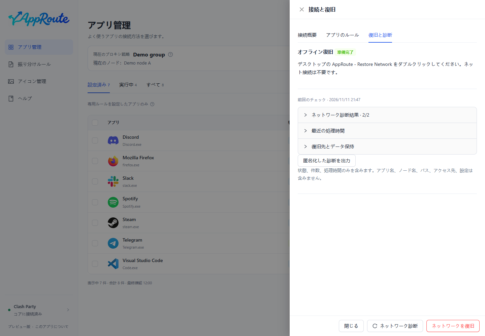

# 更新・復旧・アンインストール

## 更新

1. 「このアプリについて」で版を確認し、[対応パッケージ](install.md)を取得します。
2. トレイメニューから完全に終了します。ウィンドウを閉じるだけでは終了しません。
3. Windows は新しいインストーラーを実行し、Mac はアプリケーション内の AppRoute.app を置き換えます。
4. 再起動後に版、アプリ設定、接続を確認し、ネットワーク診断を再実行します。

自動更新はありません。通常の更新では設定と復旧データを保持します。更新のためにユーザーデータを削除しないでください。失敗した場合は診断情報を保存して報告します。ダウングレード時のデータ互換性は保証しません。

## ネットワークを復旧する

復旧は AppRoute が管理するルールと専用戦略だけを無効にし、元の Clash Party 設定を保持します。回線、別 VPN、故障ノードの修復は保証できません。

1. アプリが開く場合はネットワーク復旧を選び、対象範囲を確認して実行します。
2. 結果を確認し、診断をやり直します。
3. アプリやインターネットが使えない場合は、最初の分流適用前に用意した独立した復旧入口を使います。ChatGPT やインターネットは不要です。
4. 接続詳細にローカル復旧ツールの場所が表示されます。コア停止中は再接続後に実行状態を再確認する必要があります。

診断は特定時点の記録です。状態変更やスリープ復帰後は再実行し、古い 5/5 を現在の保証と解釈しないでください。

独立入口は AppRoute - Restore Network です（Windows は .cmd、Mac は .command）。コマンドライン表示は現在中国語です。実行すると AppRoute の分流をすべて無効にするため、読み取り専用の診断として実行しないでください。

## アンインストール

分流が不要になったら、先に復旧を実行して確認し、完全終了してから削除します。終了やアンインストールだけでは永続化された Clash ルールは解除されません。Windows は既定でユーザーデータを保持し、Mac のアプリ削除も設定を消しません。ワンクリックの安全なダウングレードや版をまたぐデータ復元は未提供です。

## 問題を報告する

版情報をコピーし、OS、チップ、Clash Party / コアの版、再現手順を添えてください。匿名化済みの診断も送信前に確認します。購読、認証情報、全アプリ一覧、個人パスは投稿しないでください。
