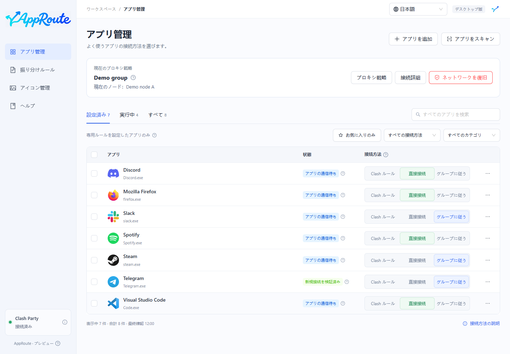
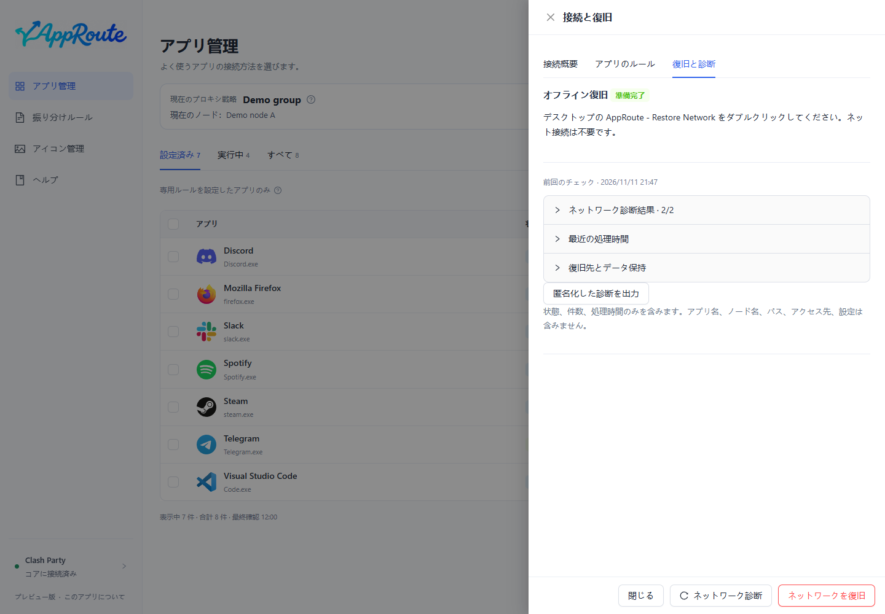

# 使い始める

目的：1 つのアプリを設定し、ルールの準備と接続の検証を区別します。

1. Clash Party を起動し、それ自体で接続できることを確認します。ルールモードを維持します。
2. AppRoute を開き、左下の接続状態を確認します。これは制御 API への接続であり、全ノードの正常性を示すものではありません。
3. 全アプリで検索するか、再スキャンします。検索対象は全アプリです。
4. 対象行で直接接続またはグループ追従を選びます。既定の Clash ルールは元の振り分けを維持します。

プロキシを使う前に[戦略](strategies.md)でグループを指定します。連続操作は待機する場合があり、選択直後に適用済みとは限りません。

## 結果の確認

ルール準備済みは「読み込み済み、接続はまだ観測していない」という状態です。新しい接続を検証した表示は、設定と一致する通信を実際に観測したことを示します。状態の説明やアプリ詳細でプロセスと経路を確認してください。

キャッシュされていない曲の再生など、新たに通信する操作を行います。既存接続は以前の経路を維持することがあり、強制的には切り替えません。

永続化用の上書きを初めて登録した際は、Clash Party を完全に終了して再起動し、保存状態を再確認する必要がある場合があります。一時的に接続が中断します。実際の検証結果を確認してください。

観測されない場合は[よくある質問](faq.md)、ネットワーク異常時は[復旧](maintenance.md#recovery)へ進みます。
