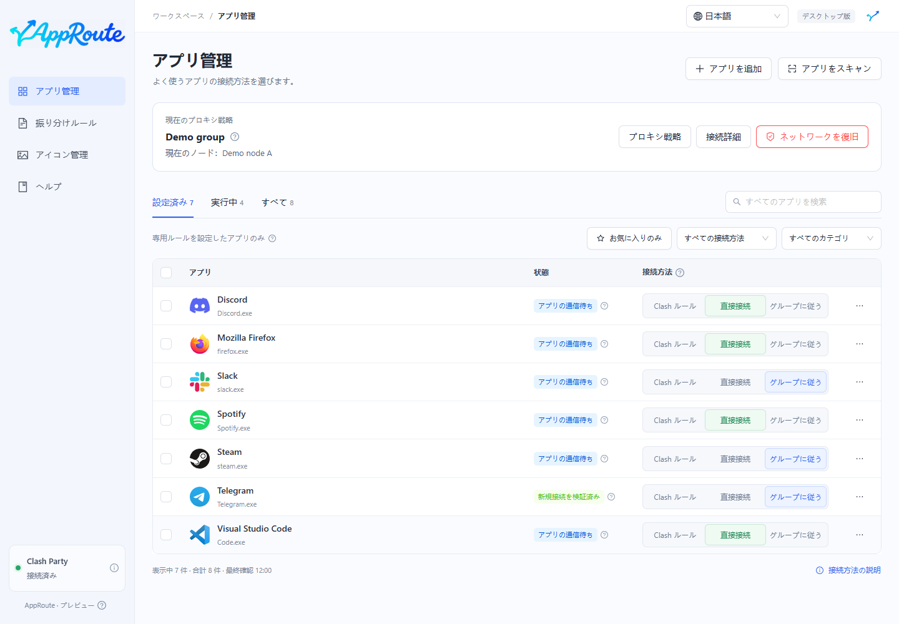
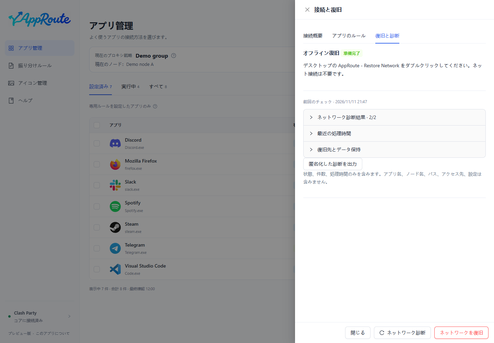

# 使い始める

目的：1 つのアプリを設定し、ルールの準備と接続の検証を区別します。

1. Clash Party を起動し、それ自体で接続できることを確認します。ルールモードを維持します。
2. AppRoute を開き、左下の接続状態を確認します。これは制御 API への接続であり、全ノードの正常性を示すものではありません。
3. 全アプリで検索するか、再スキャンします。検索対象は全アプリです。
4. 対象行で直接接続またはグループ追従を選びます。既定の Clash ルールは元の振り分けを維持します。

プロキシを使う前に[戦略](strategies.md)でグループを指定します。連続操作は待機する場合があり、選択直後に適用済みとは限りません。

## 結果の確認

ルール準備済みは「読み込み済み、接続はまだ観測していない」という状態です。新しい接続を検証した表示は、設定と一致する通信を実際に観測したことを示します。状態の説明やアプリ詳細でプロセスと経路を確認してください。

キャッシュされていない曲の再生など、新たに通信する操作を行います。既存接続は以前の経路を維持することがあり、強制的には切り替えません。

永続化用の上書きを初めて登録した際は、Clash Party を完全に終了して再起動し、保存状態を再確認する必要がある場合があります。一時的に接続が中断します。実際の検証結果を確認してください。

観測されない場合は[よくある質問](faq.md)、ネットワーク異常時は[復旧](maintenance.md#recovery)へ進みます。

## アプリ別の確認と追加設定（ソース開発版）

以下の機能は公開済みの 0.2.0-preview.2 インストーラーには含まれません。

「アプリ詳細 → このアプリを確認」で状態を読み取ります。分流は変更せず、各結果を展開すると理由を確認できます。接続サンプルにはコンポーネント、接続先、適用ルール、出口の経路、開始時刻を表示します。グループの現在の選択と観測済みの接続は別です。新しい接続がなければ観測待ちとし、設定や接続が変わったら再確認します。サンプルは全通信を表すものではありません。

アプリ詳細には、次の追加設定もあります。

- **一時的な振り分け**：15・30・60 分を選び、確認後に適用します。期限後に元の選択へ戻り、手動で早く終了することもできます。画面終了後も独立した監視が動作しますが、PC 再起動後は AppRoute を開いて再開してください。コア停止や確認失敗時は復旧待ちを表示し、成功とはしません。
- **ドメイン例外**：先にアプリを直接接続またはグループ追従に設定し、「例外を編集」を開きます。たとえば基本は直接接続のまま、`example.com` だけプロキシを使えます。完全一致またはサブドメインを含む接尾辞を最大 20 件指定できます。対象はそのアプリの識別済みプログラムパスだけです。ほかの接続先は基本設定を維持し、プロキシ例外は共通グループに追従します。グループ消失時は例外の接続を拒否し、直接接続へ切り替えません。

一時設定とドメイン例外は併用できません。Clash ルールへ戻すと、そのアプリ専用の設定と例外を削除します。キャンセルや Esc では編集を適用せず、既存接続も強制切り替えしません。シナリオ、操作履歴、パス変更については[保守と復旧](maintenance.md)をご覧ください。
