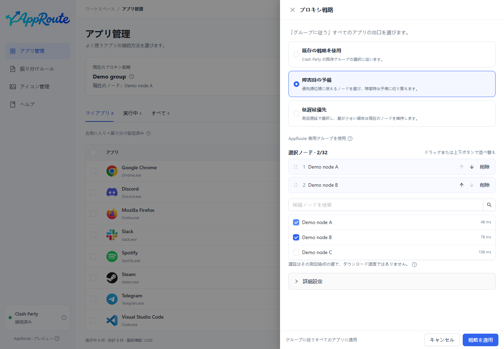

# プロキシ戦略

戦略はノードの選び方、アプリ一覧は利用するアプリを決めます。実行するのは Mihomo です。

| 戦略 | 用途 | 動作 |
| --- | --- | --- |
| 既存戦略 | 設定済みグループを使う | 元のグループの動作を維持 |
| フェイルオーバー | 優先順を指定する | 順番に利用可能な候補を選択 |
| 遅延優先 | 低遅延の候補を自動選択 | プローブと許容値を使用 |

1. アプリ管理の上部からプロキシ戦略を開きます。
2. 既存グループ、または自動戦略の候補ノードを選びます。
3. フェイルオーバーではドラッグして優先順を変更します。必要に応じて詳細設定で測定条件と対象消失時の処理を確認します。
4. 保存成功を待ち、対象アプリをグループ追従に設定します。

保存した戦略と現在の選択が上部に表示されます。実際の経路は詳細で確認します。低遅延は高速ダウンロードを意味せず、測定成功は全サイトへの接続を保証しません。

AppRoute は専用グループを作成します。自動戦略の全候補が失敗しても、黙って直接接続へ切り替えません。既存接続を強制移動しません。保存に失敗したらロールバック結果を確認し、必要なら[復旧](maintenance.md)してください。
