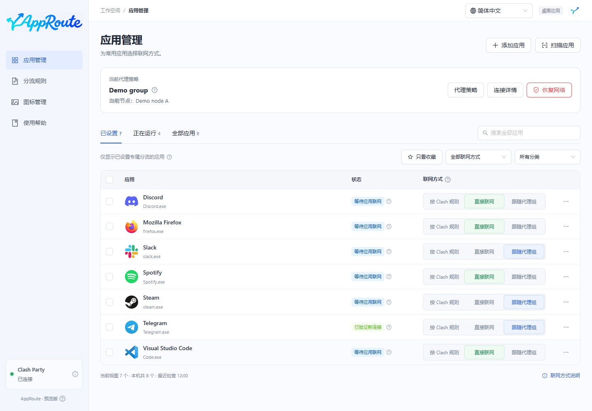

# 让应用直接联网

以 Windows 的 QQ 音乐为例。目标是让已识别、进入 Clash 的新连接使用 DIRECT，不经过远端代理节点。

## 操作

1. 确认 Clash Party 已连接，在 AppRoute 搜索“QQ 音乐”或“QQMusic.exe”。
2. 在对应应用行点击“直接联网”，等待规则就绪。
3. 打开 QQ 音乐，重新播放未缓存的内容；必要时正常退出 QQ 音乐后重开。
4. 查看应用状态和详情，确认观测连接使用 DIRECT。

预期：先显示规则就绪，观察到匹配连接后显示验证结果。辅助进程会按识别结果一并处理；不能识别的共享组件不承诺覆盖。

## 没有变绿怎么办

- 已缓存内容不一定产生新连接，换一个需要联网的操作。
- 在详情查看实际进程，确认属于选中的应用。
- 不遵循系统代理的软件可能未进入 Clash；仅有规则不能证明流量已被接管。

“直接联网”不会关闭其他 VPN，也不会关闭 Clash Party。撤销本应用设置，点击“按 Clash 规则”；恢复所有 AppRoute 设置，见[维护与恢复](maintenance.md)。
