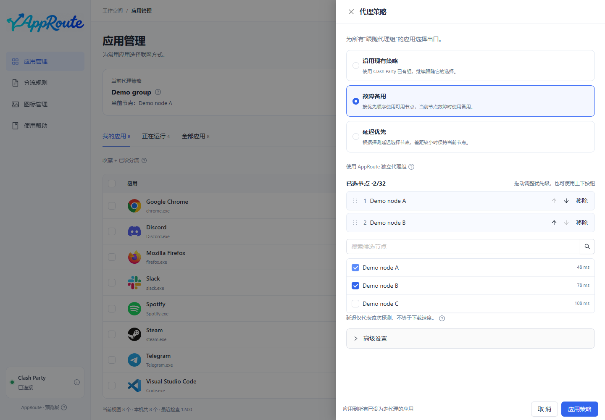

# 跟随 Clash Party 的代理组

目标：在 Clash Party 切换一次节点，已设置跟随该组的应用的新连接一起跟随。

## 操作

1. 打开“代理策略”，选择“沿用现有策略”。
2. 选择你平时实际切换节点的组，例如“节点选择”；不同组的当前选择可能独立，不能只看节点名称相同。
3. 保存策略，再为目标应用选择“跟随代理组”。
4. 在 Clash Party 切换该组的节点，让目标应用建立新连接，在应用详情核对实际出口。

预期：顶部显示组当前选择；应用详情显示实际观察到的连接。这两项不是同一份证据。旧连接可能仍走原节点。

## 需要注意

手动选择组不会自行切换故障节点。需要自动选择时，使用已有的自动组，或配置[故障备用 / 延迟优先](strategies.md)。

如果组最终选到 DIRECT，连接也可能直连；“跟随代理组”不等于保证使用远端节点。目标组消失时按已保存的异常处理设置执行，详情会提示核对。无法确认时先撤销该应用专属分流或[恢复网络](maintenance.md)。
