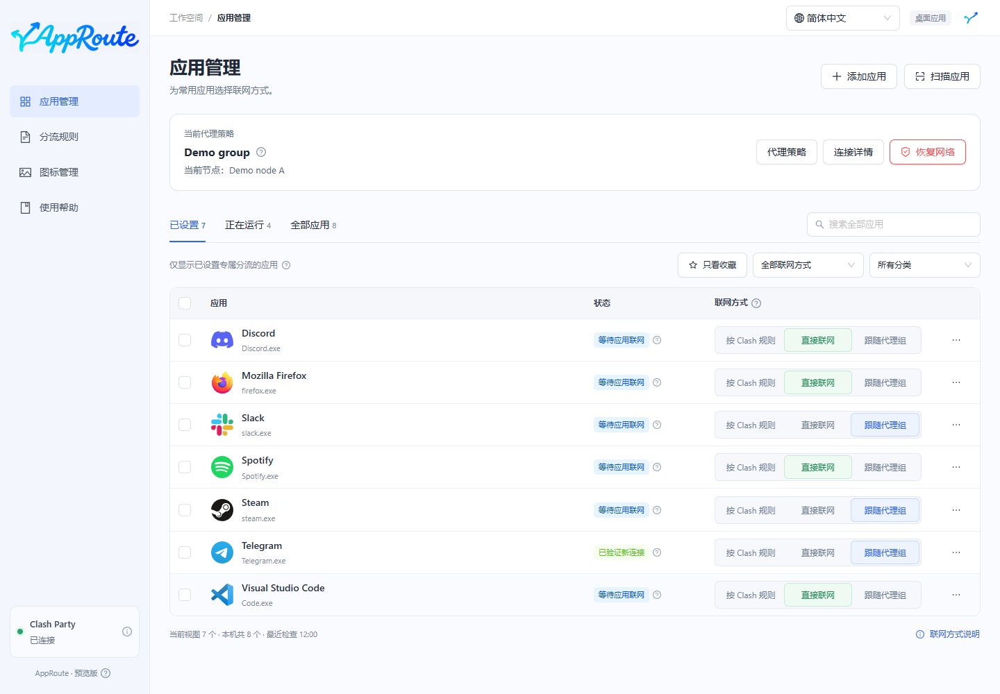

# AppRoute 使用指南

为每个应用选择联网方式，保留 Clash Party 的原有规则。

AppRoute 是 Clash Party 的应用分流助手，不提供代理节点，也不替代 Clash Party。先安装并启动 Clash Party，再使用本指南。

| 你想做什么 | 从这里开始 |
| --- | --- |
| 第一次安装 | [选择安装包](install.md) → [首次使用](quickstart.md) |
| 让 QQ 音乐等应用直连 | [设置直接联网](direct.md) |
| 切换节点时让应用一起跟随 | [跟随代理组](follow-group.md) |
| 配置备用节点或自动选择 | [代理策略](strategies.md) |
| 升级、恢复或卸载 | [维护与恢复](maintenance.md) |
| 已设置但不知道是否生效 | [常见问题](faq.md) |

截图使用隔离演示数据，不代表你的应用、节点或连接状态。当前为预览版；Mac 为实验性构建，详细边界见[支持范围](install.md#支持范围)。
