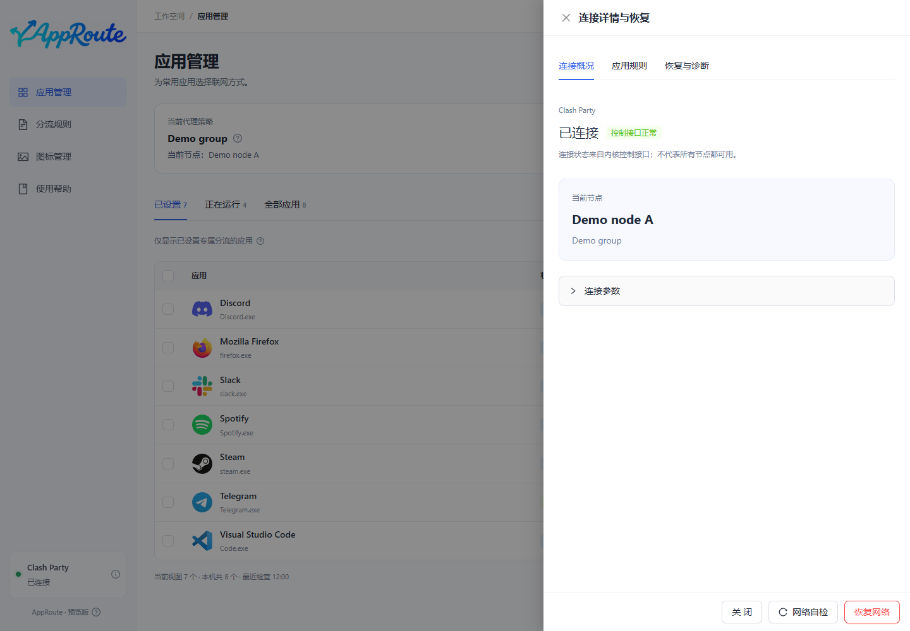

# 升级、恢复与卸载

## 升级

1. 在“关于”查看当前版本，在[下载页](install.md)选择对应系统和架构。
2. 从托盘菜单完全退出 AppRoute；关闭窗口只会隐藏。
3. Windows 运行新安装器；Mac 退出后替换“应用程序”中的 AppRoute.app。
4. 重开后核对“关于”、应用设置及连接状态，再做一次网络自检。

当前没有自动更新。正常升级保留本机应用资料、联网设置和恢复数据；不要为了升级删除用户数据目录。更新失败时保留诊断信息并反馈，不应反复强制覆盖。降级的数据兼容性未承诺，不推荐直接覆盖旧版。

## 恢复网络

“恢复网络”只停用 AppRoute 管理的规则和专用策略，保留用户原有 Clash Party 配置。它不保证修复运营商、其他 VPN 或节点本身的故障。

1. 应用能打开时，点击“恢复网络”并查看操作范围，再确认。
2. 恢复完成后，核对结果并重新进行网络自检。
3. AppRoute 无法打开或无法联网时，使用首次应用分流前准备的独立恢复入口；无需 ChatGPT 或互联网。
4. 在“连接详情”查看本机离线恢复工具的位置。Clash 内核离线时，运行态恢复需等待重新连接后继续核对。

自检结果是一次检查的记录，请看时间；状态变化或唤醒后需要重新检查。不要把旧的 5/5 当成当前网络保证。

独立恢复入口名为 AppRoute - Restore Network，Windows 使用 .cmd，Mac 使用 .command；命令行提示目前仍为中文。它会实际停用全部 AppRoute 分流，不能当作只读自检运行。

## 设置迁移（源码开发版）

本轮新增功能尚未包含在已发布的 0.2.0-preview.2 安装包中。在新版“设置与备份”中导出 JSON，导入时先预览并勾选应用；已有分流默认不勾选，路径不匹配的应用不可导入。

“仅导入资料”只合并资料与收藏；“导入并应用”需要确认，所选应用通过现有失败恢复流程应用。默认沿用当前代理组；只有主动勾选才恢复文件中的策略或语言。恢复策略会同时迁移当前所有代理应用，确认前核对提示。每次导入先备份；文件包含本机路径和节点名称，不要公开上传。

下方“本机备份”可立即备份、按时间预览恢复、导出或确认删除一份备份。手动及导入前备份包含完整设置，分流历史只恢复规则和策略，不清除现在的收藏与分类。损坏或未完成记录禁止直接恢复。恢复前仍需勾选应用；删除备份不改变当前分流或离线恢复工具。

## 卸载

若不再需要 AppRoute 分流，先执行恢复并确认，再完全退出、卸载。仅退出或卸载应用不等于撤销已持久化的 Clash 规则。Windows 卸载默认保留用户数据；Mac 将应用移除也不会自动清除设置。当前不提供一键安全降级或跨版本数据回滚承诺。

## 报告问题

在“关于”复制版本信息，提供系统、芯片、Clash Party / 内核版本和复现步骤。可使用应用的脱敏诊断导出，但上传前仍应检查内容。不要上传订阅地址、密钥、代理密码、完整扫描结果或个人路径。
