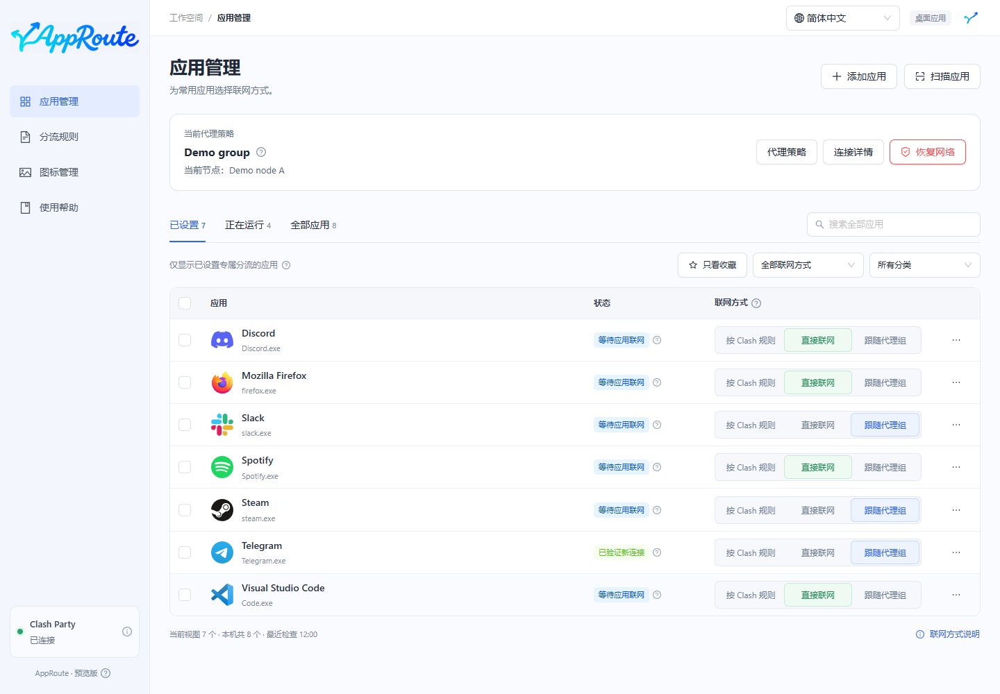
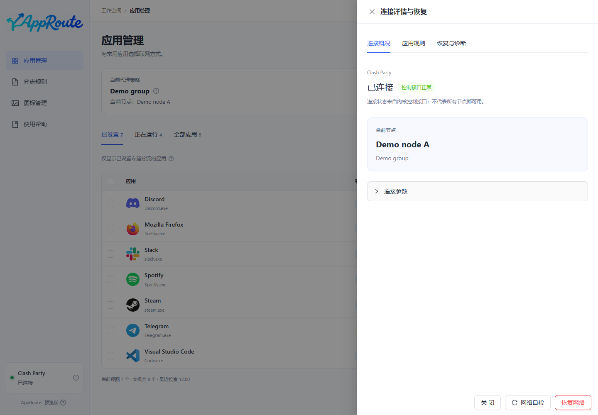

# 首次使用

目标：为一个应用设置联网方式，并判断规则是否已经加载。

## 操作

1. 启动 Clash Party，确认它自身能联网，并保持规则模式。
2. 打开 AppRoute。左下角应显示 Clash Party 已连接；这表示控制接口可访问，不保证每个节点都可用。
3. 在“全部应用”搜索软件，或点击“扫描应用”。列表来自本机扫描；搜索会覆盖全部应用。
4. 点击该应用的“直接联网”或“跟随代理组”。默认“按 Clash 规则”保持原有规则，不添加 AppRoute 专属规则。

选择代理前，先在[代理策略](strategies.md)中指定使用哪一组。可以连续操作；等待中的选择还不代表已经生效。

## 怎样判断成功

- **规则已就绪**：规则已经加载，尚未观察到匹配的新连接。
- **已验证新连接**：观察到了符合设置的新连接。绿色表示这一步已经验证。
- 点击状态旁的问号或应用详情，查看匹配进程、出口和验证说明。

让目标应用重新发起联网操作，例如播放一首尚未缓存的歌曲。已有长连接可能继续使用旧出口，AppRoute 不会自动强制断开。

首次登记持久化覆写后，可能需要正常退出并重新打开 Clash Party，再检查“重启后保留”状态；期间代理连接可能短暂中断。不要把提示消失当成验证通过，应查看实际检查结果。

如果没有匹配连接，见[常见问题](faq.md)；网络异常时使用[恢复网络](maintenance.md#恢复网络)。
