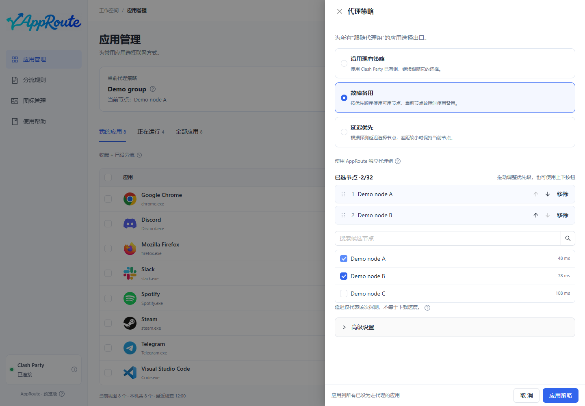

# 代理策略

只配置“节点怎么选”；应用列表负责“哪些应用使用它”。底层策略由 Mihomo 执行。

| 策略 | 适合场景 | 执行方式 |
| --- | --- | --- |
| 沿用现有策略 | 已在 Clash Party 配好组 | 引用现有组，保留其选择方式 |
| 故障备用 | 希望优先用某个节点 | 按你排列的顺序选择可用候选 |
| 延迟优先 | 希望自动选择低延迟节点 | 在候选中按探测与容差选择 |

## 操作

1. 点击应用管理顶部的“代理策略”。
2. 沿用现有策略时选择一个组；故障备用或延迟优先时勾选候选节点。
3. 故障备用中拖动候选顺序；需要时展开高级选项核对探测参数和目标消失时的处理。
4. 保存并等待成功，再为应用选择“跟随代理组”。

预期：顶部显示保存的策略和组当前选择；详情可查看实际连接。延迟不是下载速度，探测通过也不代表所有目标网站都能访问。

AppRoute 的自动策略使用独立专用组；全部候选不可用时不会静默直连。切换策略不会强制迁移旧连接。保存失败时保留错误提示并核对回退结果，必要时[恢复](maintenance.md)。
